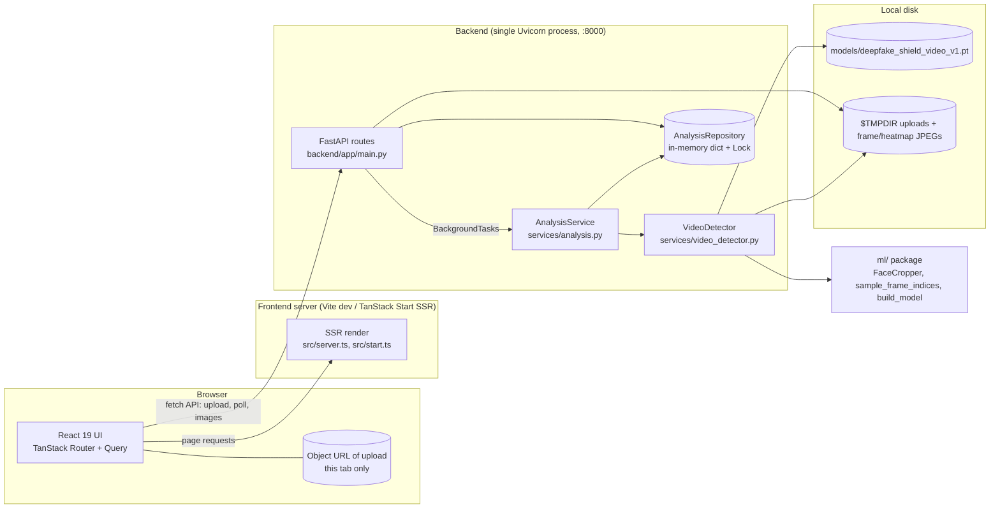
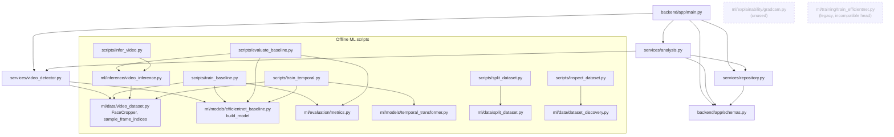
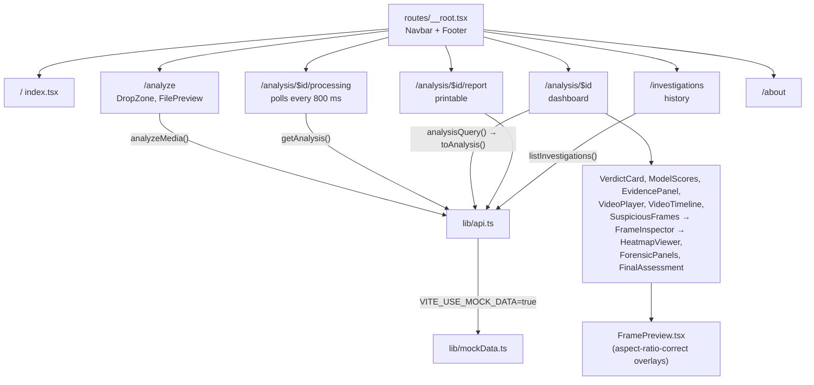
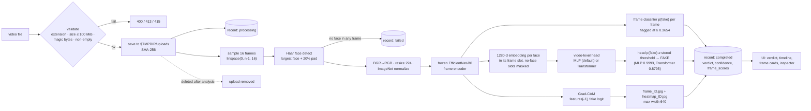
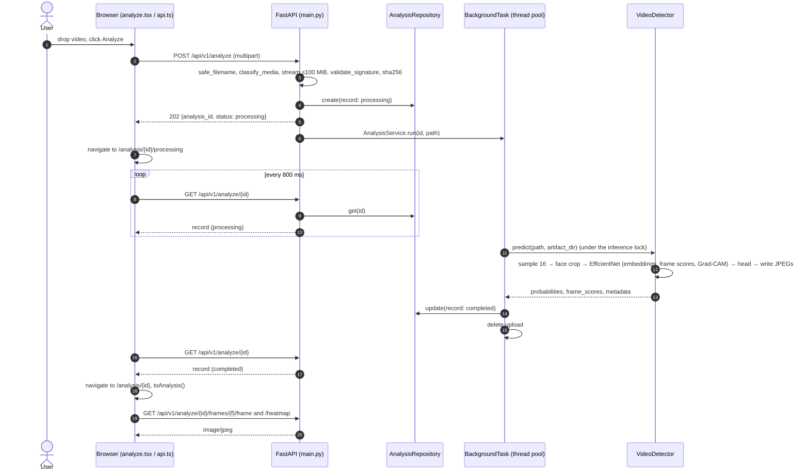
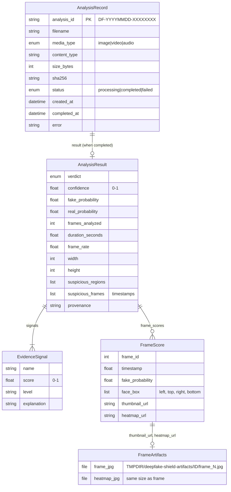

# DeepFake Shield Architecture

These diagrams show the system **as implemented** on 2026-10-24, not the multimodal vision in `DeepFake Shield.pdf`. Dashed nodes are present in the code but not part of the live request path. For details, see [`PROJECT_TECHNICAL_DOCUMENTATION.md`](PROJECT_TECHNICAL_DOCUMENTATION.md).

---

## 1. High-level architecture

**How to explain it:**

1. **The browser talks to two servers.**
   - The **frontend server** only renders pages.
   - The **FastAPI backend** does all the analysis. The browser calls it directly, which is why CORS is configured.
2. **The backend is one process with three layers:**
   - routes (HTTP and validation);
   - a service (orchestration);
   - a detector (the ML).
3. **State is held in two places only:** memory (records) and the temp directory (files). There is no database.

---

## 2. Module dependency diagram

**Key point:** `video_detector.py` imports `FaceCropper` and `build_model` from the **same `ml/` code used for training**. This prevents "training/serving skew". The offline evaluator (`video_inference.py`) still differs in two ways: it falls back to the full frame when no face is found, and it defaults to 16 frames.

---

## 3. Frontend structure

---

## 4. End-to-end data flow (video)

---

## 5. Request lifecycle (sequence)

**Failure branches:**

- A `VideoInferenceError` (no face, unreadable video, missing model) or an `OSError` → `record: failed` with the reason → the processing page stops.
- **Any other exception** is logged and the record is marked `failed` with a generic internal-error message (D3, fixed).
- In every case the upload is deleted (`try/finally` in `AnalysisService.run`).

---

## 6. Entity / data model

There is no database. These are the in-memory Pydantic models (`backend/app/schemas.py`):

---

## 7. Offline ML pipeline

```mermaid
flowchart LR
    RAW[("datasets/raw<br/>6,529 mp4")] --> AUD["inspect_dataset.py<br/>label by folder, probe, SHA-256"]
    AUD --> REP[("artifacts/dataset_report.json")]
    REP --> SPL["split_dataset.py<br/>hash-grouped 70/15/15 per class, seed 42"]
    SPL --> CSV[("train 4,207 · val 902 · test 902")]
    CSV --> TR["train_baseline.py<br/>EfficientNet-B0, AdamW 1e-4,<br/>mean logits over frames, best by val ROC-AUC"]
    TR --> CK[("best_model.pt")]
    CK --> EV["evaluate_baseline.py<br/>predict_video, binary_metrics"]
    EV --> MET[("test_metrics.json, predictions, timelines")]
    CK -. "copied as" .-> PROD[("models/deepfake_shield_video_v1.pt<br/>(trained off-machine, epoch 2)")]
    PROD -. "frozen encoder" .-> EX["extract_embeddings.py (Colab T4)<br/>6,011 videos × 16 × 1280"]
    EX --> HD["head training (Colab)<br/>MLP + Transformer, 100 epochs,<br/>best epoch by inner-val ROC-AUC"]
    HD --> HK[("models/deepfake_shield_meanpool_mlp_v1.pt<br/>models/deepfake_shield_temporal_v1.pt")]
```

---

## 8. Vision vs. implementation

| Vision component (PDF) | Implemented? |
| --- | --- |
| Video deep-learning detector | Yes (frozen EfficientNet-B0 encoder + learned MLP head, 16 frames) |
| Explainable AI | Yes (Grad-CAM per frame, face boxes) |
| Temporal analysis | Transformer head trained and selectable (`DEEPFAKE_MODEL=temporal`); it does not beat the order-blind MLP |
| Image detector | Placeholder |
| Audio detector | Placeholder |
| Metadata / compression / provenance forensics | No (UI shows "Not available") |
| Evidence fusion, risk score | No (verdict comes from one model) |
| Database, authentication, deployment | No |
