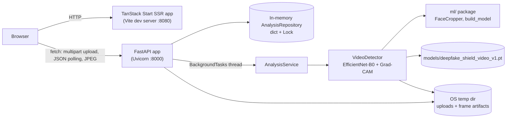

# Complete Codebase, Architecture, Technology Stack, Implementation and Project Review Guide

**Project:** DeepFake Shield (`deep-fake` repository, GitHub `GokulM8/deep-fake-shield`)
**Prepared:** 2026-10-24, against commit `236785b`. **Updated:** 2026-10-28 on branch `review-hybrid` for the D1–D3 fixes, the traceable evaluations and the served hybrid model (§1.2, §1.5, §3, §6.2, §6.6–6.7, §8.1, §9, §10.2, §10.4, §13, §14)
**Companion documents:** [`ARCHITECTURE.md`](ARCHITECTURE.md) (diagrams) and [`PROJECT_REVIEW_AND_VIVA_GUIDE.md`](PROJECT_REVIEW_AND_VIVA_GUIDE.md) (review preparation)

---

## How to read this document

Every claim is tagged with one of these labels when it matters:

| Label | Meaning |
| --- | --- |
| **Verified** | I ran it or read it directly in the code during this analysis (2026-10-24, updated 2026-10-28). |
| **Recorded** | Read from an artifact in the repository (JSON, checkpoint, CSV), not reproduced. |
| **Reported** | Stated in documentation with no supporting artifact found. |
| **Inferred** | A reasonable conclusion from evidence, not proven. |
| **Recommendation** | My suggestion, not something present in the code. |

**What was run (all read-only or temporary-directory only):**

- `python -m pytest -q` in `backend/` (13 passed on 2026-10-24; **31 passed** on 2026-10-28).
- `npx tsc --noEmit` and `npx eslint .` in `frontend/` (0 type errors; 0 lint errors, 10 warnings).
- A timing script calling `VideoDetector.predict()` on 10 local videos.
- A concurrency script calling `VideoDetector.predict()` from 4 threads.
- Reading checkpoint metadata with `torch.load`.

**What was not run:**

- `npm run build`, because it writes build output.
- Training or evaluation scripts, because they need the full dataset and take hours.
- Any deployment.

---

## 1. Project Overview

### 1.1 Plain-language explanation

Deepfakes are videos where a person's face has been swapped or synthesized by AI. They are hard to spot by eye.

DeepFake Shield is a web application where you upload a video and get back:

- a verdict ("likely authentic" or "likely manipulated");
- how confident the model is;
- which frames it looked at, and the face it found in each one;
- a heatmap showing which parts of the face most influenced the "fake" score.

The idea is that an investigator should see *why* the tool reached its answer, not just a yes/no.

### 1.2 Technical explanation

The system has three parts:

1. **React/TypeScript single-page application** (`frontend/`), built on TanStack Start with server-side rendering. It uploads a file, polls for the result, and renders a forensic dashboard and a printable report.
2. **FastAPI service** (`backend/`). It validates uploads, stores them temporarily, and runs analysis as an in-process background task. Results are kept in an in-memory repository.
3. **PyTorch machine-learning package** (`ml/`, `scripts/`). It audits the dataset, makes leakage-checked video-level splits, trains EfficientNet-B0, extracts frame embeddings, trains video-level heads, and evaluates every model through the serving code.

**How a video is analyzed (default `DEEPFAKE_MODEL=mlp`):**

1. Sample 16 evenly spaced frames.
2. Find the largest face in each frame with an OpenCV Haar cascade, and pad the box by 20%.
3. Resize the crop to 224×224 and apply ImageNet normalization.
4. Run the **frozen** EfficientNet-B0 `models/deepfake_shield_video_v1.pt` once on all face crops. This gives a 1280-d embedding per face, the frame classifier's own fake probability per face, and (with one backward pass) a Grad-CAM map per face.
5. Place each embedding in its frame slot (no-face slots masked) and run the **mean-pool MLP head** `models/deepfake_shield_meanpool_mlp_v1.pt`. Say "fake" if its probability is ≥ the threshold stored in the checkpoint (0.9993).
6. Flag individual frames whose frame-classifier probability is ≥ 0.3654, and save the frame and heatmap as JPEG images served by the API.

`DEEPFAKE_MODEL=temporal` swaps in the Transformer head (threshold 0.8795); `DEEPFAKE_MODEL=baseline` averages the frame probabilities instead (threshold 0.3654).

### 1.3 Problem, users, scope

- **Problem (from `DeepFake Shield.pdf`, the project vision document):** plain real/fake classifiers don't explain *why*, *where* or *when* manipulation happened. The vision proposes deep learning plus metadata, compression, provenance and temporal analysis, combined by "evidence fusion".
- **Intended users (Inferred from the vision document and UI copy):** journalists, digital investigators, trust-and-safety analysts, and researchers.
- **Scope actually delivered:** video-only model inference with frame-level explainability. Image and audio uploads are accepted, but they return **deterministic placeholder scores**, not predictions (`backend/app/services/analysis.py:109`, `_placeholder_result`).

### 1.4 Inputs and outputs

| | Detail |
| --- | --- |
| Input | One file per request through `POST /api/v1/analyze`. Video: `.mp4 .mov .avi .webm`. Image: `.jpg .jpeg .png .webp`. Audio: `.wav .mp3 .flac .m4a`. Limit 100 MB. |
| Output (video) | `AnalysisRecord` JSON. It contains the verdict, `confidence`, `fake_probability`, `real_probability`, `frames_analyzed`, `frame_scores[]` (frame id, timestamp, probability, face box, image URLs), resolution, fps, duration, evidence signals, and suspicious timestamps. Each analyzed frame also gets two JPEG artifacts (frame and Grad-CAM heatmap). |
| Output (image/audio) | Same record shape, but the scores come from a SHA-256 hash of the file bytes. They mean nothing. |

### 1.5 Feature status

| Feature | Status | Evidence |
| --- | --- | --- |
| Video upload, validation, async analysis | **Complete** | `backend/app/main.py:111`; tests in `backend/tests/test_api.py` |
| Hybrid video inference (frozen EfficientNet-B0 + MLP / Transformer head, 16 frames) | **Complete** | `backend/app/services/video_detector.py`, `ml/models/video_heads.py` |
| Per-frame Grad-CAM heatmaps, frame images, face boxes | **Complete (new, 2026-10-24)** | `video_detector.py:145`, `:171`; `main.py:190`; 2 tests |
| Forensic dashboard, timeline, frame inspector, report page | **Complete for video** | `frontend/src/routes/analysis.$id.*.tsx` |
| Investigations history list | **Partial**: in-memory, lost on restart | `repository.py`; `routes/investigations.tsx` |
| Dataset audit and leakage-checked splits | **Complete** | `ml/data/dataset_discovery.py`, `ml/data/split_dataset.py`, `artifacts/splits/*.csv` |
| Training and evaluation pipeline | **Complete; traceable** | `scripts/train_baseline.py`, `scripts/evaluate_full.py`, `scripts/make_ablation_table.py`, `artifacts/evaluations/` |
| Embedding extraction and head training | **Complete** (run on Colab T4) | `scripts/extract_embeddings.py`, `notebooks/hybrid_temporal_colab.ipynb`, `artifacts/evaluations/hybrid_colab/` |
| Temporal Transformer head | **Complete, selectable** (`DEEPFAKE_MODEL=temporal`); not the default | `ml/models/video_heads.py::TemporalHead` |
| Image deepfake detection | **Placeholder** | `analysis.py:109` |
| Audio deepfake detection | **Placeholder** | `analysis.py:109` |
| Metadata, codec, compression, provenance forensics | **Not implemented** (UI shows "Not available"/"Not analyzed") | `frontend/src/lib/api.ts`, `toAnalysis` |
| Database persistence | **Not implemented** (`DATABASE_URL` in `.env.example` is never read) | `grep getenv` finds only the `DEEPFAKE_*` serving variables |
| Authentication and authorization | **Not implemented** | No auth code anywhere |
| Deployment | **Not done** | No Dockerfile, CI, or hosting configuration |

### 1.6 What makes it different from a basic classifier

- **Explanations are tied to the model, not invented.** The Grad-CAM map comes from the actual gradients of the fake-class logit in the same forward pass that produced the score. I checked that the score equals the plain `no_grad` score (0.020694 for both on `00272.mp4`).
- **Honest uncertainty labelling.** The evidence text says "this score is a model probability, not calibrated certainty" (`analysis.py`). Mock-only visuals are labelled as demos.
- **Leakage-aware data engineering.** Splits are grouped by SHA-256 file hash, and the split refuses to run if identical files carry conflicting labels (`split_dataset.py:16-21`).

---

## 2. Complete Technology Stack

Versions marked "installed" were read from `backend/.venv` and `frontend/node_modules` on 2026-10-24. "Declared" is the range in the manifest.

### 2.1 Backend and ML (Python)

| Technology | Category | Declared | Installed | Purpose and where used | Why appropriate | Alternatives and trade-offs |
| --- | --- | --- | --- | --- | --- | --- |
| Python | Language | (none pinned) | 3.14.7 (`backend/.venv`) | Everything in `backend/`, `ml/`, `scripts/` | The ML ecosystem standard | No realistic alternative for PyTorch work |
| FastAPI | Web framework | `>=0.115,<1` | 0.161.1 | `backend/app/main.py`: routes, upload handling, OpenAPI `/docs` | Async-capable, Pydantic validation, auto docs | Flask (simpler, no built-in validation or docs); Django (heavier, ORM not needed yet) |
| Starlette | ASGI toolkit (FastAPI dependency) | transitive | 1.9.0 | `BackgroundTasks`, `FileResponse`, CORS middleware | Comes with FastAPI | — |
| Uvicorn (`[standard]`) | ASGI server | `>=0.30,<1` | 0.54.0 | Runs the app (`python -m uvicorn app.main:app --reload`) | Standard FastAPI server | Gunicorn with Uvicorn workers for multi-process production |
| Pydantic v2 | Data validation | `>=2.8,<3` | 2.14.1 | `backend/app/schemas.py`: all request/response models | Typed contracts, range checks (`Field(ge=0, le=1)`) | dataclasses with manual validation |
| python-multipart | Multipart parsing | `>=0.0.9,<1` | 0.0.32 | Needed by FastAPI for `UploadFile` | Required for form uploads | — |
| PyTorch | Deep-learning framework | `>=2.4,<3` | 2.14.1 (CPU on this Mac) | Model load, inference, Grad-CAM backward pass | Dominant research framework | TensorFlow/Keras; ONNX Runtime for faster CPU inference only |
| torchvision | Vision models and transforms | `>=0.19,<1` | 0.29.1 | `efficientnet_b0`, `transforms.Resize/ToTensor/Normalize` | Ships EfficientNet-B0 and ImageNet weights | `timm` (more architectures) |
| OpenCV (`opencv-python`) | Computer vision | `>=4.10,<5` | 4.14.0 | Video decoding (`cv2.VideoCapture`), Haar face detection, resizing, colormaps, JPEG writing | One library covers decode, detection and image I/O | PyAV/decord (decoding); MTCNN/RetinaFace/MediaPipe (more accurate face detection) |
| NumPy | Numerics | `>=1.26,<3` | 2.5.4 | Frame arrays, frame index sampling, heatmap maths | Standard | — |
| Pillow | Imaging | `>=10.4,<12` | 11.3.0 | Converting crops to PIL for torchvision transforms | Required by torchvision transforms | — |
| pytest | Test runner | `>=8.0,<9` | 8.4.2 | `backend/tests/` | Standard | unittest |
| httpx | HTTP client | `>=0.27,<1` | 0.28.1 | Used by FastAPI `TestClient` | Required by TestClient | — |
| scikit-learn | ML metrics | `ml/requirements.txt`: `>=1.5,<2` | **not installed in `backend/.venv`** | `ml/evaluation/metrics.py` (`roc_auc_score`, etc.), `scripts/train_baseline.py` | Reliable metric implementations | Hand-written metrics |
| pandas | Data frames | `ml/requirements.txt` | not in backend venv | Only `ml/training/train_efficientnet.py` (legacy script) | — | csv module (used elsewhere) |
| matplotlib | Plotting | `ml/requirements.txt` | — | **Declared but not imported anywhere** (Verified with grep) | — | — |
| tqdm | Progress bars | **not declared** | not installed | Imported by `ml/training/train_efficientnet.py`; **that script fails to import as-is** | — | — |

### 2.2 Frontend (TypeScript)

| Technology | Category | Declared | Installed | Purpose and where used | Why appropriate | Alternatives |
| --- | --- | --- | --- | --- | --- | --- |
| Node.js / npm | Runtime / package manager | — | Node 24.12.0, npm 11.12.1 | Dev server, build | — | Bun (a `bun.lock` also exists, so both lockfiles are present) |
| TypeScript | Language | `^5.8.3` | 5.9.3 | All `frontend/src` code; strict mode with `exactOptionalPropertyTypes` (`tsconfig.json`) | Type-safe API contract mapping | Plain JavaScript |
| React | UI library | `^19.2.0` | 19.3.0 | All components | Component model, ecosystem | Vue, Svelte |
| TanStack Start / Router | Full-stack framework, file-based routing, SSR | `1.168.32` / `1.170.18` | same | `src/routes/*.tsx`, `src/router.tsx`, `src/start.ts`, `src/server.ts` | Type-safe routes, loaders, SSR | Next.js, React Router |
| TanStack React Query | Server-state cache | `^5.101.1` | 5.102.8 | `analysisQuery`, `investigationsQuery` in `src/lib/api.ts` | Caching and suspense for API data | SWR, hand-written fetch |
| Vite | Build tool / dev server | `8.1.5` | 8.1.5 | `vite.config.ts` through `@lovable.dev/vite-tanstack-config` 2.22.0 | Fast development | Webpack |
| Nitro | Server build target | `3.0.260603-beta` | same | Build-only (Cloudflare default target per `vite.config.ts` comment) | Comes with the template | — |
| Tailwind CSS | Styling | `^4.2.1` | 4.3.3 | `src/styles.css`, all class names | Utility-first, matches template | CSS modules |
| Radix UI + shadcn-style components | Accessible primitives | various `^1.x` | — | `src/components/ui/*` (46 files) | Accessible building blocks | MUI, Chakra |
| lucide-react | Icons | `^0.575.0` | 0.575.0 | Icons across the UI | — | — |
| Recharts | Charts | `^2.15.4` | 2.15.4 | Only imported by the template's `components/ui/chart.tsx`; the timeline (`VideoTimeline.tsx`) is custom markup | — | — |
| zod, react-hook-form | Validation, forms | declared | — | Template dependencies; not central to the analysis flow | — | — |
| ESLint + Prettier | Lint and format | `^9.32.0` / `^3.7.3` | 9.39.5 / 3.9.6 | `eslint.config.js`, `.prettierrc` | Consistent code | Biome |

**Provenance of the frontend scaffold (Verified):** `frontend/.lovable/project.json` names the template `tanstack_start_ts_current`. `frontend/AGENTS.md` says the project is connected to Lovable (an AI app builder), `package.json` is named `tanstack_start_ts`, and `frontend/README.md` is mostly a Lovable generation prompt. The UI scaffold was therefore AI-generated and then integrated with the real backend. Be ready to say this openly in a review.

### 2.3 Data, model artifacts and services

| Item | Status |
| --- | --- |
| Dataset (`datasets/raw/`) | Local only, gitignored. 6,529 `.mp4` files across `Celeb-real` (482), `YouTube-real` (230), `Celeb-Youtube-fake` (5,299) and `test` (518, unlabeled). **Recorded** in `artifacts/dataset_report.json`. |
| Model checkpoint | `models/deepfake_shield_video_v1.pt` (16.3 MB, tracked in git, SHA-256 prefix `646618db85ac00aa`) |
| Database | None. `.env.example` lists `DATABASE_URL` "for future persistence"; no code reads it. |
| External APIs / cloud services | None at runtime. Google Colab and Drive appear only in training instructions (`docs/colab_video_training.md`). |
| CI/CD, containers | None present. |

### 2.4 Declared vs used vs documented

| Category | Items |
| --- | --- |
| Declared **and** used | FastAPI, Uvicorn, Pydantic, python-multipart, PyTorch, torchvision, OpenCV, NumPy, Pillow, pytest, httpx, scikit-learn (ML scripts), React, TanStack, Tailwind, Radix, lucide |
| Declared but **not used** | matplotlib (no imports); most of the 46 `components/ui/*` files and their Radix packages, which come with the template (Inferred: not all are referenced) |
| Used but **not declared** | `tqdm` (in `ml/training/train_efficientnet.py`) |
| Configured but **not operational** | `DEEPFAKE_SHIELD_MAX_UPLOAD_BYTES`, `DEEPFAKE_SHIELD_UPLOAD_ROOT`, `FACEFORENSICS_ROOT`, `CELEBDF_ROOT`, `DATABASE_URL` in `.env.example`: **none are read by any code**. The only environment variable read is `DEEPFAKE_MODEL_PATH` (`video_detector.py:42`), and it is **not** listed in `.env.example`. |
| Documented but **not implemented** | From the vision PDF: image/audio models, metadata, compression and provenance forensics, evidence fusion, database, authentication, deployment |

---

## 3. Repository Structure and File-by-File Explanation

```text
deep-fake/
├── backend/                 FastAPI service (production code + tests)
│   ├── app/main.py          App, validation helpers, all HTTP routes
│   ├── app/schemas.py       Pydantic data contracts
│   ├── app/services/        analysis.py, video_detector.py, repository.py
│   ├── tests/               test_api.py, test_video_detector.py
│   └── requirements.txt
├── ml/                      Reusable ML package (imported by backend and scripts)
│   ├── data/                dataset_discovery.py, split_dataset.py, video_dataset.py
│   ├── models/              efficientnet_baseline.py, temporal_transformer.py
│   ├── inference/           video_inference.py (used by scripts, not backend)
│   ├── evaluation/          metrics.py
│   ├── explainability/      gradcam.py (unused, see 3.3)
│   ├── training/            train_efficientnet.py (legacy, see 3.3)
│   └── datasets/            inspect_datasets.py (older inventory tool)
├── scripts/                 CLI entry points for the ML workflow
├── frontend/                TanStack Start + React application
├── models/                  deepfake_shield_video_v1.pt (deployed checkpoint)
├── artifacts/               dataset report, splits, experiments, evaluations, timelines
├── reports/                 Older dataset inventories (JSON)
├── docs/                    colab_video_training.md
├── datasets/                raw/ and processed/ (gitignored contents)
├── README.md, backend/README.md, PROJECT_REVIEW.md, DeepFake Shield.pdf
└── .env.example, .gitignore
```

### 3.1 Backend (production code)

#### `backend/app/main.py`

The application's entry point. It creates the singletons, validation helpers and every HTTP route.

- **Constants:**
  - `MAX_UPLOAD_BYTES = 100 MiB` (`:26`).
  - `UPLOAD_ROOT` (`:27`) and `ARTIFACT_ROOT` (`:30`), both under the OS temp directory. `ARTIFACT_ROOT` is wiped with `shutil.rmtree` at import time.
  - `ALLOWED_MEDIA` (extension allow-list per media type).
  - `MAGIC_SIGNATURES` (the leading bytes expected for each extension).
- **Singletons created at import:** `repository = AnalysisRepository()`, `video_detector = VideoDetector()` (loads the model once), `analysis_service = AnalysisService(...)`, `app = FastAPI(...)`.
- **CORS:** allows `127.0.0.1`/`localhost` on ports 5173, 5500 and 8080; methods GET and POST only.
- **Helpers:**
  - `classify_media()` (`:75`) maps the extension to a `MediaType`; anything else returns 415.
  - `safe_filename()` (`:83`) keeps only `Path(name).name`, which strips directories.
  - `validate_signature()` (`:90`) checks the magic bytes. For RIFF formats it also checks the subtype (`WEBP`, `WAVE`, `AVI `).
- **Routes:** see the table in §7.
- **Startup:** `video_detector = create_detector()` reads `DEEPFAKE_MODEL` (default `mlp`); invalid serving configuration stops the server. The background job is `AnalysisService.run` (the former `_run_and_cleanup` wrapper was removed with the D3 fix).
- **Unused import:** `secrets` is imported but never used.

#### `backend/app/schemas.py`

Pydantic models: `AnalysisStatus`, `MediaType`, `Verdict` (string enums), `EvidenceSignal`, `FrameScore`, `AnalysisResult`, `AnalysisRecord`, `HealthResponse` (now also `model` and `decision_threshold`). Probabilities are range-checked to 0–1.

`FrameScore` has three fields added on 2026-10-24: `face_box`, `thumbnail_url` and `heatmap_url`.

#### `backend/app/services/analysis.py`

`AnalysisService` is the orchestrator.

- **`run()`:** wraps `_run()` in `try/finally` and always deletes the upload. `_run()` fetches the record; for video it calls `_video_result()`, otherwise `_placeholder_result()`. It saves a `COMPLETED` record; an `OSError` or `VideoInferenceError` gives `FAILED` with the reason, and any other exception is logged and gives `FAILED` with a generic internal-error message.
- **`_video_result()` (`:59`):**
  - calls `VideoDetector.predict(media_path, artifact_dir)`;
  - adds the artifact URLs to each frame;
  - builds two evidence signals: the active model's video probability (named e.g. "EfficientNet-B0 + MLP head"), and face coverage (frames with a face ÷ frames requested);
  - sets the verdict (`LIKELY_MANIPULATED` if the prediction is FAKE, otherwise `LIKELY_AUTHENTIC`);
  - lists suspicious timestamps (frames whose frame-classifier probability ≥ `frame_threshold`, 0.3654).
- **`_placeholder_result()` (`:109`):** derives "scores" from the first 3 bytes of the file's SHA-256 hash. Clearly scaffolding.
- **`sha256_file()` (`:159`):** streams the file in 1 MB chunks.

#### `backend/app/services/video_detector.py`

The model wrapper.

- **Imports from `ml/`:** it adds `ml/` to `sys.path`, then imports `FaceCropper`, `sample_frame_indices`, `build_model` and `load_head`, so training, evaluation and serving share the same preprocessing code.
- **Module helpers:** `build_transform()` (Resize 224, ToTensor, ImageNet Normalize), `sample_faces()` (16 evenly spaced frames → largest padded face per frame, with each frame's slot), `embed_and_score()` (embedding + frame probability in one pass).
- **`VideoDetector` (`baseline`):** loads the frame classifier (`DEEPFAKE_MODEL_PATH`); threshold `DEEPFAKE_THRESHOLD` or 0.3654; frames `DEEPFAKE_FRAMES` or 16; invalid values raise at startup. A load failure is stored in `load_error` (→ `/health` `degraded`) instead of crashing the app. A `threading.Lock` serializes `predict()` / `score_frames()` / `score_video()` (D1/D2 fix).
- **`EmbeddingHeadDetector` (`mlp`, `temporal`):** subclasses `VideoDetector`, keeps the frame classifier as a frozen encoder, and loads the head (`DEEPFAKE_HEAD_PATH` or the default checkpoint). The threshold defaults to the head checkpoint's stored value; frames must equal its `n_frames` (16). `_score_with_gradcam()` runs the backbone once to get the embeddings (for the head), the frame logits (for frame scores and Grad-CAM), and then the head's video probability.
- **`create_detector()`:** reads `DEEPFAKE_MODEL` (`mlp` default, `temporal`, `baseline`); anything else raises `ValueError` at startup.
- **`_predict_with_gradcam()`:** attaches a forward hook to `model.features[-1]`, runs forward, then backward on the frame classifier's `logits[:, 1].sum()`, and returns per-frame probabilities and Grad-CAM maps normalized to 0–1.
- **`_write_frame_artifacts()`:** draws the heatmap over the face crop, keeps everything else black, downsizes to at most 640 px wide, and writes `frame_<id>.jpg` and `heatmap_<id>.jpg`.
- **Labels used by the API and UI:** `inference_mode`, `signal_name` (e.g. "EfficientNet-B0 + MLP head"), `frame_threshold` (0.3654 in every mode) and `provenance`.

#### `backend/app/services/repository.py`

`AnalysisRepository` is a `dict` guarded by a `threading.Lock`, with methods `create`, `get`, `list` (newest first) and `update`. Its docstring says it should be replaced by PostgreSQL.

#### Tests (`backend/tests/`)

See §8.

### 3.2 ML package (`ml/`) and scripts

| File | Responsibility | Key symbols | Used by |
| --- | --- | --- | --- |
| `ml/data/dataset_discovery.py` | Walks the dataset; labels by folder name (`real`/`original` → 0, `fake`/`manipulated`/`deepfake` → 1); probes with OpenCV; hashes every file | `discover_videos`, `build_report`, `_label_for_directory` | `scripts/inspect_dataset.py` |
| `ml/data/split_dataset.py` | Splits 70/15/15 per class, grouped by SHA-256 hash; verifies no hash crosses splits | `create_splits`, `_verify_no_hash_overlap`, `write_split_csvs` | `scripts/split_dataset.py` |
| `ml/data/video_dataset.py` | Uniform frame sampling, Haar face cropping, a lazy PyTorch `Dataset` | `sample_frame_indices`, `FaceCropper.locate/crop`, `VideoFrameDataset` | backend, training, evaluation |
| `ml/models/efficientnet_baseline.py` | EfficientNet-B0 with `Dropout(0.3)` + `Linear(1280, 2)` head | `build_model(pretrained, dropout)` | backend, all scripts |
| `ml/models/video_heads.py` | **Served heads:** `TemporalHead` and `MeanPoolMLP` (module names match the checkpoints) and `load_head` | `TemporalHead`, `MeanPoolMLP`, `load_head` | backend, tests |
| `ml/models/temporal_transformer.py` | Earlier Transformer over per-frame embeddings (local experiments) | `TemporalTransformer` | `scripts/train_temporal*.py` |
| `ml/inference/video_inference.py` | Offline video scoring (default 16 frames; **falls back to the full frame if no face**; "suspicious" threshold 0.7) | `predict_video` | `scripts/infer_video.py`, `scripts/evaluate_baseline.py` |
| `ml/evaluation/metrics.py` | Accuracy, precision, recall, F1, ROC-AUC, PR-AUC, FPR, FNR, support | `binary_metrics` | training and evaluation scripts |
| `ml/explainability/gradcam.py` | A Grad-CAM class | `GradCAM` | **Nothing** (dead code; the backend has its own implementation) |
| `ml/training/train_efficientnet.py` | Alternative trainer: **1-output head with `BCEWithLogitsLoss`**, needs pandas and tqdm | `get_efficientnet_model`, `train_model` | **Nothing**; its checkpoints cannot load into the 2-output production model |
| `ml/datasets/inspect_datasets.py` | Older multi-dataset inventory (FaceForensics, Celeb-DF roots) | — | Produced `reports/*.json` |
| `scripts/inspect_dataset.py` | CLI: writes `artifacts/dataset_report.json` | — | Manual |
| `scripts/split_dataset.py` | CLI: writes `artifacts/splits/{train,val,test}.csv` | — | Manual |
| `scripts/train_baseline.py` | CLI: trains EfficientNet; AdamW, lr 1e-4, weight decay 1e-4; averages logits over frames; keeps the best checkpoint by validation ROC-AUC | `run_epoch`, `balanced_indices` | Manual / Colab |
| `scripts/evaluate_baseline.py` | CLI: video-level test evaluation; writes metrics, predictions and timelines | — | Manual / Colab |
| `scripts/train_temporal.py` | CLI: trains the Transformer on a frozen backbone | — | Manual |
| `scripts/infer_video.py` | CLI: scores one video, prints JSON | — | Manual |
| `scripts/evaluate_full.py` | CLI: val + test evaluation **through the serving code** (`--model baseline\|mlp\|temporal`); cached predictions, `metrics.json`, ROC/PR/confusion plots | `write_evaluation`, `youden_threshold` | `artifacts/evaluations/*` |
| `scripts/extract_embeddings.py` | CLI: 16-frame embeddings for every split with the serving preprocessing; sanity check against `baseline_f16` | `extract_split`, `sanity_check` | Colab notebook |
| `scripts/check_head_parity.py` | CLI: served heads on N test videos, optional comparison with Colab scores | — | Manual |
| `scripts/make_ablation_table.py` | CLI: one Markdown table from every `metrics.json` plus `hybrid_colab/ablation_colab.csv` | `colab_rows` | `artifacts/evaluations/ablation_table.md` |

### 3.3 Dead, legacy or duplicated code (Verified)

1. **`ml/explainability/gradcam.py`** is never imported. The backend implements Grad-CAM separately in `video_detector.py`. Keep one copy.
2. **`ml/training/train_efficientnet.py`** is incompatible with the production head (1 output vs 2) and imports undeclared `tqdm`.
3. **`ml/inference/video_inference.py` and the backend preprocess differently.** Offline evaluation keeps faceless frames (uses the full frame) and uses 16 frames by default. The backend skips faceless frames and uses 2. So offline test metrics do not exactly describe the deployed behaviour.

### 3.4 Frontend (`frontend/src/`)

| File | Responsibility |
| --- | --- |
| `start.ts` | TanStack Start instance: error middleware and CSRF middleware for server functions |
| `server.ts` | SSR entry wrapper that turns uncaught SSR errors into an HTML error page |
| `router.tsx` | Creates the router and a `QueryClient` |
| `routeTree.gen.ts` | Generated route tree (do not edit) |
| `routes/index.tsx` | Landing page |
| `routes/analyze.tsx` | Drop zone and file preview; calls `analyzeMedia`, then navigates to processing |
| `routes/analysis.$id.processing.tsx` | Polls `getAnalysis` every 800 ms, then redirects when completed. **The stage list and frame counter are cosmetic timers**, not backend progress. |
| `routes/analysis.$id.index.tsx` | Main dashboard: verdict, model scores, evidence, video/image viewer, timeline, suspicious frames, forensic panels, final assessment |
| `routes/analysis.$id.report.tsx` | Printable report (`?print=true` triggers `window.print()`) |
| `routes/investigations.tsx` | History table from `GET /api/v1/analyze` |
| `routes/about.tsx` | Static page |
| `lib/api.ts` | **The API contract layer.** `request()`, `analyzeMedia()`, `getAnalysis()`, `getEvidence()`, `getReport()`, `listInvestigations()`, and `toAnalysis()`, which maps backend records to UI types (severity bands, frame cards, face-box percentages). Also mock mode (`VITE_USE_MOCK_DATA`) and the uploaded-media object URLs. |
| `lib/types.ts` | UI types (`Analysis`, `SuspiciousFrame`, `EvidenceSignal`, …) |
| `lib/mockData.ts` | Demo fixtures (427 lines) for mock mode |
| `components/analysis/*` | Dashboard widgets. `FramePreview.tsx`, `SuspiciousFrames.tsx`, `FrameInspector.tsx` and `HeatmapViewer.tsx` render the real frame artifacts. |
| `components/layout/Navbar.tsx` | Navigation. **"System Status: Online" is a hard-coded label** (`:300`), not a health check. |
| `components/ui/*` | 46 generated shadcn/Radix primitives |

---

## 4. System Architecture

The full diagrams are in [`ARCHITECTURE.md`](ARCHITECTURE.md). Summary:



**Key points:**

- **The browser calls the API directly.** It uses `VITE_API_BASE_URL`; the SSR server does not proxy API calls. CORS is therefore required, and is configured for the dev ports.
- **The job pattern is fire-and-poll.**
  - `POST` saves the upload, creates a `PROCESSING` record, schedules `AnalysisService.run`, and returns `202`.
  - The client polls `GET /api/v1/analyze/{id}`.
  - FastAPI runs synchronous background tasks in a thread pool after the response is sent.
- **Validation happens at the HTTP edge** (`main.py`: extension, size, signature, filename) and in the schemas (Pydantic ranges).
- **Error handling:** expected failures (unreadable video, no face, missing model) become a `FAILED` record with a message. **Unexpected exceptions are not caught** (see §10).
- **Logging:** none beyond Uvicorn's access log; no structured or request-scoped logs.
- **Authentication and authorization:** none.
- **Configuration:**
  - Backend: one environment variable (`DEEPFAKE_MODEL_PATH`); everything else is hard-coded constants.
  - Frontend: `VITE_API_BASE_URL` and `VITE_USE_MOCK_DATA` (`frontend/.env.local`), read at Vite startup.
- **Secrets:** none are needed or present in tracked files. `.env.example` holds only placeholders.

**Architectural patterns present:**

- **Service layer:** `AnalysisService`.
- **Repository pattern:** `AnalysisRepository`, swappable for a database.
- **Adapter/anti-corruption layer:** `toAnalysis()` in `api.ts` maps the backend contract to UI types.
- **Asynchronous job with polling.**
- **Shared library between training and serving:** the `ml/` package.

---

## 5. Detailed Implementation Walkthrough

### 5.1 Workflow A: uploading and analysing a video (the core path)

1. **Trigger.** The user drops a file on `/analyze`. `routes/analyze.tsx` calls `analyzeMedia({file, filename, mediaType, sizeBytes})`.
2. **Client request.** `lib/api.ts` `analyzeMedia()`:
   - builds `FormData` and `POST`s it to `${API_BASE_URL}/api/v1/analyze`;
   - saves submission context in `sessionStorage`;
   - creates an object URL for the local preview (`uploadedMediaUrls`).
3. **Server entry.** `create_analysis()` (`main.py:111`):
   1. `safe_filename()` strips any path.
   2. `classify_media()` checks the extension; failure returns 415.
   3. It generates the ID `DF-YYYYMMDD-XXXXXXXX` (8 hex characters from `uuid4`).
   4. It streams the upload to `UPLOAD_ROOT/<id><ext>` in 1 MB chunks, and aborts with **413** once 100 MiB is exceeded.
   5. It rejects empty files with **400**.
   6. `validate_signature()` checks the magic bytes; a mismatch returns **415**.
   7. It computes the SHA-256, stores a `PROCESSING` record, schedules `AnalysisService.run`, and returns **202** `{analysis_id, status}`.
4. **Background job.** `AnalysisService.run()` wraps `_run()` in `try/finally`, so the upload is always deleted.
5. **Video branch.** `_video_result()` → `video_detector.predict(path, artifact_dir=ARTIFACT_ROOT/<id>)` (an `EmbeddingHeadDetector` in the default `mlp` mode), under the inference lock:
   1. `cv2.VideoCapture` reads the frame count, fps, width and height. A file that cannot be opened, or has 0 frames, raises `VideoInferenceError`.
   2. `sample_frame_indices(frame_count, 16)` uses `np.linspace(0, n-1, 16)`: 16 evenly spaced frames, each with its slot index.
   3. For each sampled frame, `FaceCropper.locate()`:
      - converts it to grayscale;
      - runs `detectMultiScale(scaleFactor=1.1, minNeighbors=5, minSize=32×32)`;
      - keeps the **largest** face and pads it by 20%, clamped to the frame.
      Frames with no face are skipped.
   4. If no face is found in any frame, it raises `VideoInferenceError("No detectable face…")`.
   5. Each crop is converted BGR→RGB, resized to 224×224, turned into a tensor, and normalized with ImageNet mean/std. The crops are stacked into a batch.
   6. `_score_with_gradcam()` runs the frozen backbone once: the pooled embeddings ([N, 1280]) are kept for the head, the frame classifier's logits give each frame's fake probability, and a backward pass from those fake logits gives the Grad-CAM maps.
   7. The embeddings are placed in their slots of a [1, 16, 1280] tensor with a face mask, and the head returns the **video** fake probability. Prediction is FAKE if it is ≥ the head's stored threshold (0.9993 for the MLP). `confidence` is the probability of the predicted class. (In `baseline` mode the video score is the mean of the frame probabilities, threshold 0.3654.)
   8. The per-frame artifacts are written as JPEGs.
6. **Result assembly.**
   - `_video_result()` adds `thumbnail_url`/`heatmap_url` and builds `signals` (named after the active model) and `suspicious_frames` (timestamps whose frame-classifier p ≥ 0.3654).
   - `run()` saves `COMPLETED`, with `completed_at` set.
7. **Polling and rendering.**
   - The processing page polls every 800 ms and redirects to `/analysis/$id` once the status is completed.
   - The dashboard route loader calls `analysisQuery(id)`, and `toAnalysis()` maps the record:
     - severity bands: ≥75 HIGH, ≥45 or flagged MEDIUM, otherwise LOW;
     - frame cards sorted by score;
     - face box converted to percentages of width/height.
   - `FramePreview`/`SuspiciousFrames`/`FrameInspector` load the JPEGs from the frames endpoint.
8. **Errors.**
   - Validation errors return 400/413/415 to the client, and `request()` throws `Backend request failed (<status>)`.
   - Inference errors produce a `FAILED` record, and the processing page stops.
   - **Any other exception** is logged and produces a `FAILED` record with a generic message (D3, fixed; see §10.2).
9. **Evidence.**
   - `test_real_video_upload_returns_model_result`, `test_video_frame_artifacts_are_served`.
   - Live runs against the running server on 2026-10-24 (baseline) and 2026-10-28 (default MLP mode): status `completed`, and 200 `image/jpeg` for every artifact.

### 5.2 Workflow B: image or audio upload

The validation path is the same. `run()` then calls `_placeholder_result()`:

- `visual = 0.55 + digest[0]/255 × 0.35`; the forensic and temporal "scores" are built the same way from the next two bytes.
- `confidence` is a weighted sum. The verdict is `LIKELY_MANIPULATED` if it is ≥ 0.7, otherwise `INCONCLUSIVE`.
- Images always report `suspicious_regions=["face boundary"]`.

**These are not predictions.** The tests `test_upload_completes_and_returns_evidence` and `test_analysis_history_returns_uploaded_records` use this path.

### 5.3 Workflow C: dataset preparation, training and evaluation (offline)

1. `scripts/inspect_dataset.py` → `discover_videos()` + `build_report()` writes `artifacts/dataset_report.json`: counts, hashes, duplicates, durations, fps, resolutions, and `source_grouping.available = false`.
2. `scripts/split_dataset.py` → `create_splits(seed=42)`:
   - keeps only labeled, readable records;
   - groups them by SHA-256;
   - refuses to continue if a group has conflicting labels;
   - per label, shuffles the groups and greedily fills train/val/test toward 70/15/15;
   - verifies there is no hash overlap, then writes the CSVs.
3. `scripts/train_baseline.py`:
   - uses `VideoFrameDataset` (N frames per video, with full-frame fallback);
   - the model sees `B×T` crops, and the logits are **averaged over the T frames** before the cross-entropy loss (video-level supervision);
   - AdamW, lr 1e-4, weight decay 1e-4;
   - optional ImageNet initialization (`--pretrained`);
   - saves `last_model.pt` every epoch, and `best_model.pt` when validation ROC-AUC improves;
   - `--limit N` takes a class-balanced subset.
4. `scripts/evaluate_baseline.py`:
   - runs `predict_video()` on each test row;
   - computes `binary_metrics`;
   - writes `test_metrics.json`, `video_predictions.csv`, and one timeline JSON per video.
5. The deployed checkpoint was trained outside this machine (Inferred: on Colab, per `docs/colab_video_training.md`). Its SHA-256 differs from every local experiment checkpoint, and the checkpoint itself records `epoch: 2`.

### 5.4 Workflow D: mock mode

With `VITE_USE_MOCK_DATA=true`, every API function returns fixtures from `mockData.ts`, and `MockBanner` is shown. The demo heatmap gradient and the "Demonstration visualisation" disclaimer appear only in this mode.

---

## 6. Algorithms, Models and Core Logic

### 6.1 EfficientNet-B0 frame classifier

- **Problem:** decide whether a face crop is real or manipulated.
- **Concept:** a convolutional network found by neural architecture search and scaled uniformly in depth, width and resolution ("compound scaling"). It is built from MBConv blocks (inverted residuals, depthwise convolutions) with squeeze-and-excitation.
- **This implementation:**
  - `torchvision.models.efficientnet_b0`, with the classifier replaced by `Dropout(0.3) → Linear(1280, 2)` (`ml/models/efficientnet_baseline.py`);
  - **4,010,110 parameters** (Verified);
  - input 224×224 RGB, ImageNet-normalized;
  - output 2 logits; softmax index 1 = fake.
- **Why chosen (Inferred):** a strong accuracy/compute trade-off and ImageNet weights available in torchvision, so it runs on CPU in under 1 s per video. EfficientNet backbones were common in the Kaggle Deepfake Detection Challenge.
- **Cost:** about 0.39 GFLOPs per 224×224 image (published figure for B0). It runs once per sampled frame.
- **Strengths:** small, fast, transfer-learning friendly.
- **Weaknesses:**
  - looks at single frames only, with no motion cues;
  - relies on face crops;
  - not calibrated;
  - fine-tuned on only ~1,000 of the 4,207 training videos (Inferred from checkpoint metadata), then frozen.
- **Alternatives:** Xception (the FaceForensics++ baseline), EfficientNet-B4/B7 (more accurate, slower), Vision Transformers, and video models (3D CNNs, TimeSformer).

### 6.2 Frame sampling and video-level aggregation

- `sample_frame_indices(n, k) = linspace(0, n-1, k)`. In production k = 16 (it was 2 until 2026-10-26; 16 beat 2 on every test metric).
- Aggregation: a **learned head** over the frame embeddings (default), or the **mean** of frame probabilities in `baseline` mode. Mean, median, top-3 and max of frame probabilities were all compared (§9.1).
- **Edge cases:**
  - Very short videos: for a 1-frame video, both indices are 0, so the same frame is analyzed twice.
  - Videos that report 0 frames raise an error.
  - Manipulation that only appears mid-video can be missed entirely.
- **Alternatives:** more frames, max-pooling or top-k aggregation (more sensitive to short manipulations), and temporal models.

### 6.3 Haar cascade face detection (Viola–Jones)

- **Concept:** a boosted cascade of Haar-like rectangle features, evaluated quickly with integral images over a multi-scale sliding window.
- **Parameters:** `scaleFactor=1.1`, `minNeighbors=5`, `minSize=(32,32)`, and 20% padding. Only the largest face is used.
- **Strengths:** fast, no extra model download, ships with OpenCV.
- **Weaknesses:**
  - misses profile, tilted, small, occluded or low-light faces;
  - false positives on textures;
  - only one face per frame.
- **Alternatives:** MTCNN, RetinaFace, MediaPipe, and dlib CNN. These are more accurate but add dependencies.

### 6.4 Grad-CAM (Gradient-weighted Class Activation Mapping)

- **Problem:** show which spatial regions pushed the model toward "fake".
- **Concept:** take the activations `A` of the last convolutional layer and the gradients `∂y_fake/∂A`.
  - The channel weight is `α_k = mean over (i,j) of ∂y/∂A_k`.
  - The map is `ReLU(Σ_k α_k · A_k)`.
- **This implementation** (`video_detector.py:145-169`):
  - the hook is on `model.features[-1]` (1280×7×7 for a 224 input), and the target is the fake-class **logit** (pre-softmax);
  - one backward pass serves the whole batch, which is valid because eval-mode BatchNorm keeps samples independent;
  - each map is normalized to its own maximum, then upsampled bicubically to the face crop size;
  - it is colorized with JET, multiplied by the map intensity, and placed on a black frame-sized canvas, so it can be blended (CSS `mix-blend-screen`) over the frame image.
- **Resolution:** only 7×7, so the maps are coarse.
- **Caveat:** because each map is normalized per frame, a very low-probability frame still shows a full-intensity hotspot. The intensity is relative, not absolute.
- **Evaluation:** qualitative only. No localization ground truth exists in this dataset.
- **Alternatives:** Grad-CAM++, Score-CAM, Integrated Gradients, attention rollout (for ViTs), and supervised localization (FaceForensics++ masks).

### 6.5 Hash-grouped stratified split

- **Problem:** avoid the same file appearing in both train and test.
- **How:**
  - group records by SHA-256 (identical bytes means the same group);
  - per class, shuffle the groups (seed 42) and fill the splits greedily up to 70% and 15%; the remainder goes to test;
  - then assert no cross-split hash.
- **Cost:** O(N) after hashing. Hashing is O(total bytes).
- **Limitation:** it only catches **byte-identical** duplicates. The same person or source video (identity leakage) can still appear in several splits. `dataset_report.json` records `source_grouping.available: false` for this reason.
- **Result (Verified from the CSVs):**

  | Split | Videos | Real | Fake |
  | --- | ---: | ---: | ---: |
  | train | 4,207 | 498 | 3,709 |
  | val | 902 | 107 | 795 |
  | test | 902 | 107 | 795 |

### 6.6 Hybrid video-level heads (served)

The served model is a **two-stage hybrid**: the EfficientNet-B0 of §6.1 is frozen and used as a frame encoder, and a small learned head makes the video-level decision (`ml/models/video_heads.py`, `backend/app/services/video_detector.py::EmbeddingHeadDetector`).

- **Embedding:** `flatten(avgpool(features(x)))`, 1280-d per face crop. Each embedding is placed in its sampling slot of a 16 × 1280 tensor; slots whose frame had no face stay zero and are masked out (`mask` True = face).
- **MLP head (`mlp`, default, 331,010 parameters):** masked mean over the 16 slots → `LayerNorm(1280) → Linear(1280, 256) → GELU → Dropout(0.2) → Linear(256, 2)`. It ignores frame order.
- **Transformer head (`temporal`, 1,915,138 parameters):** `LayerNorm(1280) → Linear(1280, 256)`, plus a learnable positional table (16 × 256); a 2-layer pre-norm `TransformerEncoder` (4 heads, feed-forward 1024, dropout 0.2) with the no-face slots as padding; masked mean pooling; `LayerNorm → Dropout → Linear(256, 2)`.
- **Loading:** `load_head` builds the class named by `checkpoint["head"]` and loads the state dict strictly. The checkpoint also stores `threshold`, `n_frames=16`, `embed_dim=1280`, `encoder_checkpoint` and (Transformer only) `best_epoch`.
- **Training (Recorded in the checkpoints' `config`, run on a Colab T4):** embeddings for all 6,011 labelled videos were extracted once with the serving preprocessing (~3.5 h). Heads were trained for a fixed 100 epochs with no early stopping (`patience=100`), keeping the epoch with the best inner-val ROC-AUC (inner-val = 15% of train). AdamW lr 3e-4, weight decay 1e-2, cosine schedule, batch 64, frame dropout 0.25, class-weighted cross-entropy, seed 42. The validation split only tunes the threshold (Youden's J); test is only for reporting.
- **Best epochs:** Transformer epoch 6 (inner-val ROC-AUC 0.9699, Recorded in `best_epoch` and `history.csv`); MLP epoch 75 (inner-val ROC-AUC 0.9797, **Reported** from the Colab cell output; see `artifacts/evaluations/hybrid_colab/mlp_training_note.md`).
- **Overfitting (Recorded, `history.csv`):** Transformer inner-val loss is lowest at epoch 1 (0.277) and rises to 0.618 by epoch 100 while training loss falls to 0.0005.
- **Why the frame encoder is frozen:** one extraction pass, then each head trains in minutes; the head is too small to memorize images; the backbone still supplies frame scores and Grad-CAM.
- **What the ablation shows:** the order-blind MLP beats the Transformer (98.86% vs 97.83% test ROC-AUC), so the gain over the baseline comes from **learned aggregation**, not temporal modelling (§9.1).

The older `ml/models/temporal_transformer.py` / `scripts/train_temporal_embeddings.py` pipeline (padding-mask convention, optional projection) is kept for reproducibility of the local experiments but is not what is served.

### 6.7 Decision rules and UI mapping

| Rule | Value | Location |
| --- | --- | --- |
| Video FAKE threshold (`mlp`, default) | head p ≥ **0.9993** (stored in the checkpoint) | `models/deepfake_shield_meanpool_mlp_v1.pt` |
| Video FAKE threshold (`temporal`) | head p ≥ **0.8795** | `models/deepfake_shield_temporal_v1.pt` |
| Video FAKE threshold (`baseline`) | mean frame p ≥ **0.3654** (val Youden J, 16 frames) | `video_detector.py`, `DEFAULT_THRESHOLD` |
| Override | `DEEPFAKE_THRESHOLD` (validated at startup: 0 < t < 1) | `video_detector.py` |
| Suspicious frame (backend) | frame-classifier p ≥ **0.3654** in every mode | `VideoDetector.frame_threshold`, `analysis.py::_video_result` |
| Severity bands (UI) | ≥75 HIGH, ≥45 or flagged MEDIUM, else LOW | `frontend/src/lib/severity.ts` |
| Placeholder verdict | confidence ≥ 0.7 → manipulated, else inconclusive | `analysis.py` |

The UI labels frame scores as **"Frame-level evidence (EfficientNet-B0)"** and the verdict as the **"Video-level decision"** of the active head (e.g. "EfficientNet-B0 + MLP head").

### 6.8 Metrics (`ml/evaluation/metrics.py`)

- Accuracy, precision, recall and F1 use `zero_division=0`.
- ROC-AUC and PR-AUC are `None` when only one class is present, so a fake value is never reported.
- FPR and FNR are also reported.
- **Interpretation note:** with 88% fake samples, **ROC-AUC and PR-AUC are more informative than accuracy.** PR-AUC is high partly because the positive class dominates.

---

## 7. Data, APIs and Integrations

### 7.1 API endpoints (Verified in `backend/app/main.py`)

| Method | Path | Request | Success | Errors |
| --- | --- | --- | --- | --- |
| GET | `/health` | — | 200 `{status: "ok" \| "degraded", service, inference_mode}` | — |
| POST | `/api/v1/analyze` | multipart `file` | **202** `{analysis_id, status: "processing"}` | 400 empty or invalid filename; 413 > 100 MiB; 415 bad extension or signature; 500 storage failure |
| GET | `/api/v1/analyze` | — | 200 `AnalysisRecord[]`, newest first (**every record, anyone can read**) | — |
| GET | `/api/v1/analyze/{id}` | — | 200 `AnalysisRecord` | 404 |
| GET | `/api/v1/analyze/{id}/evidence` | — | 200 `EvidenceSignal[]` (`[]` until complete) | 404 |
| GET | `/api/v1/analyze/{id}/report` | — | 200 `AnalysisRecord` (same as the GET by id) | 404 |
| GET | `/api/v1/analyze/{id}/frames/{frame_id}/{frame\|heatmap}` | `frame_id: int`, `kind` must be one of the two | 200 `image/jpeg` | 404 unknown analysis or artifact; 422 bad `kind` or non-integer `frame_id` |
| GET | `/docs`, `/openapi.json` | — | FastAPI-generated | — |

There are no retries, no rate limits, and no pagination.

### 7.2 Key data structures

**`AnalysisRecord`:**

- `analysis_id`, `filename`, `media_type` (`image|video|audio`), `content_type`, `size_bytes`, `sha256`;
- `status` (`processing|completed|failed`), `created_at`, `completed_at?`, `result?`, `error?`.

**`AnalysisResult`:**

| Field | Meaning (video) |
| --- | --- |
| `verdict` | `likely_manipulated` or `likely_authentic` (video never returns `inconclusive`) |
| `confidence` | Probability of the predicted class (= `fake_probability` if fake, otherwise `real_probability`) |
| `fake_probability` / `real_probability` | Mean softmax over the analyzed frames; they sum to 1 |
| `frames_analyzed` | Frames that contained a detectable face (≤ 2) |
| `frame_scores[]` | `{frame_id, timestamp, fake_probability, face_box [l,t,r,b] in source pixels, thumbnail_url, heatmap_url}` |
| `duration_seconds`, `frame_rate`, `width`, `height` | From OpenCV container metadata |
| `signals[]` | `{name, score 0–1, level, explanation}`: model probability and face coverage |
| `suspicious_regions` | `["face boundary"]` if fake, otherwise `[]` (a fixed label, not localized) |
| `suspicious_frames` | Timestamps of frames whose frame-classifier p ≥ 0.3654 |
| `provenance` | Fixed string naming the checkpoint (not media provenance) |

### 7.3 Data lifecycle

| Data | Where | Lifetime |
| --- | --- | --- |
| Uploaded file | `$TMPDIR/deepfake-shield-uploads/<id>.<ext>` | Deleted after analysis, **unless an unexpected exception occurs** |
| Analysis record | Process memory | Until the process restarts (including `--reload`) |
| Frame and heatmap JPEGs | `$TMPDIR/deepfake-shield-artifacts/<id>/` | Until the next backend start (wiped on import) |
| Local preview of the original | Browser object URL | The uploading tab only |
| Submission context | `sessionStorage` | The browser session |

### 7.4 Dataset

- **Recorded** (`artifacts/dataset_report.json`):
  - 6,529 videos, all readable `.mp4`;
  - 712 real, 5,299 fake, 518 unlabeled `test`;
  - average duration 12.6 s (min 0.033 s, max 24.7 s); average fps 29.99;
  - mostly 944×500.
- **Identity:** the folder names (`Celeb-real`, `YouTube-real`, 518 test videos) match the Celeb-DF v2 layout (Inferred).
- **Contradiction:** the README's "Dataset links" point to the Kaggle DFDC and "Real and Fake Face Detection" datasets, not Celeb-DF. Check and correct this before the review.

### 7.5 Integrations

None at runtime: no third-party APIs and no cloud services. Training is documented for Google Colab with Google Drive storage.

---

## 8. Testing, Validation and Code Quality

### 8.1 Test inventory (`backend/tests/`, 31 tests)

| Test | Kind | What it proves | Needs local dataset? |
| --- | --- | --- | --- |
| `test_health` | API | `/health` reports the active inference mode, model name and decision threshold | No |
| `test_cors_allows_local_frontend` | API | CORS preflight for `localhost:5173` | No |
| `test_upload_completes_and_returns_evidence` | API, placeholder path | Upload → completed → evidence | No |
| `test_analysis_history_returns_uploaded_records` | API | List endpoint is ordered newest first | No |
| `test_rejects_unsupported_extension` | API | 415 for `.exe` | No |
| `test_rejects_mismatched_file_content` | API | 415 for text named `.jpg` | No |
| `test_real_video_upload_returns_model_result` | Integration (real model) | Full video path through the API | **Yes** (`datasets/raw/test/00272.mp4`) |
| `test_video_frame_artifacts_are_served` | Integration | Artifact URLs return JPEGs; 404s for unknown frames and analyses | **Yes** |
| `test_unexpected_detector_error_marks_failed_and_deletes_upload` | API, error path (D3) | A `RuntimeError` in the detector → `failed` record, upload deleted | No |
| `test_model_loads_on_cpu` | Model | Checkpoint loads, eval mode, CPU | No (checkpoint is tracked) |
| `test_face_extraction_matches_training_preprocessing` | Preprocessing | Crop → tensor of shape (3,224,224) | **Yes** |
| `test_real_video_inference_returns_expected_contract` | Model | Output keys and ranges; verdict consistent with the threshold | **Yes** |
| `test_serving_defaults_to_16_frames_at_tuned_threshold`, `test_frames_and_threshold_come_from_environment`, `test_invalid_serving_config_is_rejected` (×3) | Config | Baseline defaults (16 frames, 0.3654), env overrides, invalid values rejected | No |
| `test_video_without_detectable_face_fails_cleanly` | Model, error path | Synthetic black video raises `VideoInferenceError` | No (generated in `tmp_path`) |
| `test_inference_writes_frame_and_gradcam_artifacts` | Explainability | Frame/heatmap files exist, same shape, valid face boxes, non-zero heatmap | **Yes** |
| `test_concurrent_predictions_are_safe_and_identical` | Concurrency (D1/D2) | 4 threads give identical scores (1e-6) | **Yes** |
| `test_score_frames_matches_served_frame_scores` | Consistency | The no-Grad-CAM path matches the served frame scores (1e-5) | **Yes** |
| `test_head_checkpoints_load_strictly` (×2) | Heads | Both heads load with strict state-dict matching; stored `n_frames`, `embed_dim`, encoder name, threshold, `best_epoch` | No (checkpoints are tracked) |
| `test_serving_defaults_to_mlp_head`, `test_head_uses_its_stored_threshold_unless_overridden` (×2), `test_invalid_head_config_is_rejected` (×2) | Config | `mlp` is the default; stored threshold unless `DEEPFAKE_THRESHOLD`; unknown `DEEPFAKE_MODEL` or non-16 frames rejected | No |
| `test_each_mode_runs_on_fixture_video` (×3) | Integration | `baseline`, `mlp`, `temporal` each predict; verdict matches `score_video`; frame scores equal the backbone's; heatmaps written | **Yes** |

- **Fixtures and mocking:** none. The tests use the real model and FastAPI's `TestClient`, which runs background tasks synchronously, so "completed" is immediate.
- **Run result (Verified, 2026-10-28, Python 3.14.7):** `31 passed, 1 warning`. The warning is a Starlette deprecation for `httpx` in the TestClient.
- **Portability (Verified):** tests marked **Yes** need the gitignored `datasets/raw/test/00272.mp4`; the newer ones skip when it is missing, the older ones fail on a fresh clone (D7).

### 8.2 Static analysis

- `npx tsc --noEmit`: **0 errors** (strict, `exactOptionalPropertyTypes`, `noUncheckedIndexedAccess`).
- `npx eslint .` (with `._*` files excluded): **0 errors, 10 warnings**, all `react-refresh/only-export-components`.
- **Python:** no linter, formatter or type checker is configured (no ruff, black, mypy or pyproject).

### 8.3 Coverage gaps

- **There are no frontend tests at all.**
- **Not covered by tests:**
  - concurrency;
  - unexpected-exception handling;
  - missing checkpoint (the `degraded` health state);
  - oversized uploads (413);
  - empty uploads (400);
  - malformed containers;
  - the WebP/WAV/AVI RIFF subtype checks.
- **Training and evaluation scripts have no tests.** `split_dataset.create_splits` is easy to unit-test.
- **No end-to-end browser test.** UI correctness was checked manually and with screenshots only.

### 8.4 Known defects

See §10.2.

---

## 9. Results and Evidence

### 9.1 Model performance

Test split: 902 videos (107 real, 795 fake). Thresholds tuned on validation (Youden's J). Full table: `artifacts/evaluations/ablation_table.md` (generated by `scripts/make_ablation_table.py`).

| Model | Source | Threshold | Accuracy | Balanced acc. | Real recall | Fake recall | ROC-AUC | PR-AUC | Status |
| --- | --- | --- | ---: | ---: | ---: | ---: | ---: | ---: | --- |
| Baseline, 2 frames, mean prob. | local | 0.2431 | 76.44% | 76.53% | 76.64% | 76.42% | 83.17% | 96.68% | Recorded (`baseline_f2/metrics.json`) |
| **Baseline, 16 frames, mean prob. (official baseline)** | local | 0.3654 | 74.28% | **79.75%** | 86.92% | 72.58% | **88.13%** | 97.89% | Recorded (`baseline_f16/metrics.json`) |
| Baseline, 16 frames, mean prob. (re-run) | Colab | 0.2917 | 79.60% | 81.55% | 84.11% | 78.99% | 88.19% | 97.87% | Recorded (`hybrid_colab/ablation_colab.csv`) |
| Baseline, 16 frames, median / top-3 / max | Colab | tuned | — | 80.88 / 78.61 / 77.72% | — | — | 88.30 / 86.40 / 85.11% | — | Recorded |
| Hybrid: EfficientNet + Transformer head | Colab | 0.8795 | 94.01% | 91.75% | 88.79% | 94.72% | 97.83% | 99.65% | Recorded (`hybrid_colab/metrics.json`) |
| **Hybrid: EfficientNet + mean-pool MLP head (served)** | Colab | 0.9993 | 93.46% | **94.67%** | 96.26% | 93.08% | **98.86%** | 99.83% | Recorded (`ablation_colab.csv`) |
| Hybrid MLP head, served-pipeline re-score | local | stored 0.9993 | 92.57% | 94.17% | 96.26% | 92.08% | 98.73% | 99.81% | Recorded (`mlp_served/metrics.json`, commit `f9312a8`) |
| Hybrid Transformer head, served-pipeline re-score | local | stored 0.8795 | 94.12% | 91.81% | 88.79% | 94.84% | 97.71% | 99.63% | Recorded (`temporal_served/metrics.json`, commit `f9312a8`) |

**Interpretation:**

- **Headline:** against the local 16-frame baseline, the served hybrid raises tuned balanced accuracy **79.75% → 94.67%** and ROC-AUC **88.13% → 98.86%**.
- **Reproducibility:** the Colab re-run of the same baseline gave 88.19% / 81.55%; fp16 extraction shifted its tuned threshold (0.3654 → 0.2917), which changes balanced accuracy more than ROC-AUC. Re-scoring all 902 val and 902 test videos through the served pipeline (`mlp_served`, `temporal_served`) reproduced test ROC-AUC within 0.15 points (MLP 98.73% vs 98.86%, Transformer 97.71% vs 97.83%); at the stored thresholds, balanced accuracy was 94.17% (MLP; Colab 94.67%) and 91.81% (Transformer; Colab 91.75%). The stored thresholds themselves do not fully reproduce on locally served val scores (MLP 0.9996 vs 0.9993, Transformer 0.9797 vs 0.8795), another sign of saturated, uncalibrated scores.
- **Learned aggregation, not temporal modelling:** fixed aggregations of frame probabilities stay at 85–88% ROC-AUC; both learned heads reach ~98%; the order-blind MLP beats the Transformer. 16 evenly spaced frames are ~1 s apart, too sparse for short-range temporal artifacts.
- **Calibration limitation:** the stored thresholds (0.8795, 0.9993) show the heads are overconfident; head probabilities are not trustworthy as probabilities. Temperature scaling is the next step.
- **Accuracy is misleading** with 88% fakes; balanced accuracy and ROC-AUC are the headline metrics. With 107 real test videos, one video ≈ 0.93 points of real recall.

**Historical (superseded):** the README's earlier "55.43% accuracy / 83.01% ROC-AUC" figure (2 frames, 0.5 threshold, no committed artifact) and the checkpoint's embedded validation metrics (epoch 2: 82.31% ROC-AUC) are replaced by the traceable runs above.

### 9.2 Engineering results (Verified on 2026-10-28)

| Claim | Measurement | Procedure and limits |
| --- | --- | --- |
| Backend tests | 31/31 pass | `pytest -q`; some need the local dataset video |
| Frontend types and lint | 0 TS errors; 0 ESLint errors, 10 warnings | `tsc --noEmit`, `eslint src` |
| Per-video latency, 16 frames + Grad-CAM (median of 5) | Battery + Low Power Mode (2026-10-28): CPU 7.9 s baseline / 8.9 s MLP / 7.0 s Transformer; MPS 1.25 / 1.33 / 1.21 s. Plugged in (2026-10-26, baseline): CPU 3.9 s, MPS 0.6 s. Head forward alone: 0.05 ms (MLP), 1.1 ms (Transformer) | Apple M4; one test video; includes decoding and face detection |
| Concurrency | 4 threads give identical scores (≤ 1e-6) | `test_concurrent_predictions_are_safe_and_identical` |
| Served pipeline vs Colab | 902 test videos re-scored: ROC-AUC MLP 98.71% (Colab 98.86%), Transformer 97.71% (Colab 97.83%) | `scripts/evaluate_full.py --model mlp|temporal`, MPS |
| Model sizes | encoder 4,010,110 params (16.3 MB); MLP head 331,010 (1.3 MB); Transformer head 1,915,138 (7.7 MB) | `sum(p.numel())` |

### 9.3 Available artifacts

- `artifacts/dataset_report.json`, `artifacts/splits/*.csv`.
- `artifacts/experiments/*`: configs, histories, local checkpoints. These are **untracked** except the splits and report.
- `artifacts/evaluation/*`, `artifacts/timelines/`.
- No screenshots are committed.

---

## 10. Security, Performance and Reliability

No formal security audit has been performed. This section is a code review.

### 10.1 Controls that exist

- Extension allow-list and magic-byte signature check (`main.py:75-99`).
- Streaming upload with a hard 100 MiB cap; empty-file rejection.
- The filename is reduced to its base name. Storage uses a server-generated name (`<analysis_id><ext>`), so user input never builds a path.
- The frame artifact endpoint is safe against path traversal: it requires an existing analysis ID, `frame_id: int` and `kind ∈ {frame, heatmap}`.
- CORS is limited to local origins and GET/POST.
- Uploads are deleted after a normal analysis.
- The frontend CSRF middleware protects TanStack server functions. The app does not currently use any.

### 10.2 Defects

**Fixed (2026-10-26, covered by tests):**

| # | Defect | Fix | Test |
| --- | --- | --- | --- |
| D1 | Concurrent analyses were not thread-safe (the Grad-CAM hook on the shared model captured another request's activations) | `threading.Lock` held for the whole of `predict()` / `score_frames()` | `test_concurrent_predictions_are_safe_and_identical` (4 threads, identical to 1e-6) |
| D2 | Score drift under concurrency even without Grad-CAM (shared `cv2.CascadeClassifier`) | Same lock | Same test |
| D3 | Unexpected exceptions left records stuck in `processing` and leaked uploads | `run()` wraps `_run()` in `try/finally` (upload always deleted); any other exception is logged and the record marked `failed` | `test_unexpected_detector_error_marks_failed_and_deletes_upload` |

**Open:**

| # | Defect | Evidence | Impact | Fix |
| --- | --- | --- | --- | --- |
| D4 | **Fixed 2026-10-28:** the navbar reads `/health` every 15 s and shows Online / Degraded / Offline | `Navbar.tsx::SystemStatus` | — | — |
| D5 | Evidence IDs are assigned by position, except coverage (now mapped by name to `face`) | `api.ts::toEvidence` | Minor | Map every signal by name |
| D6 | "Faces detected" shows `frames_analyzed` | `api.ts` | Not a true face count | Return the count from the backend |
| D7 | Tests depend on an untracked video | `.gitignore` | Fresh clones fail those tests | Commit a small licensed fixture |
| D8 | `ml/training/train_efficientnet.py` is broken and incompatible | Missing `tqdm`; 1-logit head | Confusion | Delete it or mark it legacy |
| D9 | **Fixed 2026-10-28:** coverage shows COMPLETE (green) / PARTIAL; verdicts are coloured by meaning everywhere | `api.ts`, `lib/verdict.ts` | — | — |

### 10.3 Risks (not exploited, but plausible)

- **No authentication.** `GET /api/v1/analyze` returns every analysis to anyone who can reach the port. The IDs carry only 32 random bits.
- **`torch.load(..., weights_only=False)`** unpickles arbitrary objects. A malicious checkpoint at `DEEPFAKE_MODEL_PATH` could execute code.
- **Memory:** `validate_signature` calls `path.read_bytes()[:16]`, which reads the entire file (up to 100 MiB) just to check 16 bytes.
- **Denial of service:** no rate limit, no inference timeout, and an unbounded in-memory record list.
- **Error messages** include raw exception text (`"Unable to read uploaded media: …"`).
- **The startup `rmtree(ARTIFACT_ROOT)`** would wipe another worker's artifacts if several processes were started.
- **Magic-byte checks are shallow.** `b"ftyp"` anywhere in the first 12 bytes passes for MP4/MOV/M4A. That is fine for gatekeeping, but it is not real format validation.

### 10.4 Performance and scalability

- **Speed:** see §9.2. Inference is serialized by the lock, so throughput is one video at a time per process.
- **Single process:** state lives in memory, so you cannot scale with multiple Uvicorn workers.
- **Background tasks:** they run in Starlette's thread pool, with no queue, no retries and no visibility.
- **Recommendation:** a job queue (RQ/Celery/arq), PostgreSQL for records, object storage for artifacts, and batched GPU inference.

---

## 11. Setup, Execution and Deployment

### 11.1 Prerequisites

- macOS or Linux.
- Python 3.12+ (3.14.7 verified).
- Node 20+ (24.12.0 verified).
- About 2 GB of disk for PyTorch.
- The dataset is only needed for the dataset-dependent tests and for training.

### 11.2 Backend

```bash
cd backend
python3 -m venv .venv                 # isolated environment
source .venv/bin/activate
python -m pip install -r requirements.txt
python -m uvicorn app.main:app --reload   # http://127.0.0.1:8000, docs at /docs
```

- **Use `python -m uvicorn`.** A global `uvicorn` can shadow the venv one and fail with `No module named 'fastapi'`. This happened on 2026-10-24.
- **Optional:** `DEEPFAKE_MODEL_PATH=/abs/path/model.pt python -m uvicorn app.main:app`.
- **Note:** a second virtual environment exists at the repository root (`.venv`, Python 3.13). Use `backend/.venv` for the backend to avoid confusion.

### 11.3 Frontend

```bash
cd frontend
npm install
cp .env.example .env.local    # then set VITE_USE_MOCK_DATA=false for real mode
npm run dev                   # Vite dev server (this machine used port 8080)
```

`.env.local` must contain:

```dotenv
VITE_API_BASE_URL=http://127.0.0.1:8000
VITE_USE_MOCK_DATA=false
```

Restart Vite after editing it. Use `127.0.0.1`: on this machine, Docker also listens on ports 8000/8001.

### 11.4 Tests and checks

```bash
cd backend && python -m pytest -q                  # 31 tests (some need datasets/raw/test/00272.mp4)
cd frontend && npx tsc --noEmit && npm run lint    # type check + lint
npm run build                                      # production build (not run for this document)
```

### 11.5 ML workflow

```bash
python3 -m pip install -r ml/requirements.txt
python3 scripts/inspect_dataset.py      # audit → artifacts/dataset_report.json
python3 scripts/split_dataset.py        # → artifacts/splits/*.csv
python3 scripts/train_baseline.py --pretrained --epochs 5 --limit 0 --frames-per-video 8
python3 scripts/evaluate_baseline.py --checkpoint <best_model.pt> --frames 8
python3 scripts/infer_video.py --video <file.mp4> --checkpoint models/deepfake_shield_video_v1.pt --frames 16

# Traceable evaluation through the serving code (cached, resumable; writes metrics.json + plots)
backend/.venv/bin/python scripts/evaluate_full.py --checkpoint models/deepfake_shield_video_v1.pt --frames 16 \
    --out-dir artifacts/evaluations/baseline_f16
backend/.venv/bin/python scripts/evaluate_full.py --model mlp --checkpoint models/deepfake_shield_video_v1.pt \
    --frames 16 --out-dir artifacts/evaluations/mlp_served
backend/.venv/bin/python scripts/check_head_parity.py --models mlp temporal   # 20 test videos per head
backend/.venv/bin/python scripts/make_ablation_table.py                       # → artifacts/evaluations/ablation_table.md
```

Embedding extraction and head training ran on a Colab T4 from `notebooks/hybrid_temporal_colab.ipynb` (bundle built by `scripts/package_for_colab.py`); outputs are in `artifacts/evaluations/hybrid_colab/`.

**Serving configuration:** `DEEPFAKE_MODEL` (`mlp` default, `temporal`, `baseline`), `DEEPFAKE_THRESHOLD` (overrides the stored threshold), `DEEPFAKE_FRAMES` (heads require 16), `DEEPFAKE_MODEL_PATH` (frame encoder), `DEEPFAKE_HEAD_PATH` (head checkpoint).

**Note:** the split CSVs contain absolute paths from the original machine (`/Users/.../deep-fake/datasets/raw/...`). Use `--video-root` to remap them.

### 11.6 Verifying a running system

```bash
curl http://127.0.0.1:8000/health                       # {"status":"ok",...}
curl -F "file=@datasets/raw/test/00272.mp4;type=video/mp4" http://127.0.0.1:8000/api/v1/analyze
curl http://127.0.0.1:8000/api/v1/analyze/<id>          # status "completed" within ~1 s
```

### 11.7 Deployment

**Not implemented.** There is no Dockerfile, CI workflow, hosting configuration or HTTPS setup. The Vite config mentions a Cloudflare default target for Nitro, but nothing has been deployed.

### 11.8 Troubleshooting

| Symptom | Cause | Fix |
| --- | --- | --- |
| `No module named 'fastapi'` | Global `uvicorn` ran instead of the venv one | `python -m uvicorn …` or `rehash` |
| `Backend request failed (404)` | Frontend pointed at the wrong port (8001 is a Docker service here) | Fix `VITE_API_BASE_URL`; restart Vite |
| Old analysis returns 404 | The backend restarted (records are in memory) | Upload again |
| `Ignoring invalid distribution`, ESLint "Invalid character", git `non-monotonic index` | macOS `._*` AppleDouble files on the FAT32 SanDisk volume | `find . -name '._*' -delete`; `._*` is now in `.gitignore` |
| Analysis stuck on "processing" | Fixed (D1/D3); now only if the backend process died mid-analysis | Restart the backend |
| `Model checkpoint not found`, `/health` says `degraded` | Missing `models/*.pt` | Restore the checkpoint or set `DEEPFAKE_MODEL_PATH` |

---

## 12. Engineering Decisions and Alternatives

"Recorded" means the code or documentation states the reason. "Retrospective" is my assessment.

| Decision | Recorded reason | Retrospective assessment | Alternative |
| --- | --- | --- | --- |
| Video-first scope | README "What is live"; frontend README "VIDEO-FIRST" | Sensible: one real modality beats three fake ones | Image model first (simpler data) |
| EfficientNet-B0 | Not recorded | Good accuracy/compute trade-off; torchvision weights | Xception, EfficientNet-B4, ViT |
| 16 frames in production (was 2) | `artifacts/evaluations/baseline_f2` vs `baseline_f16` | 16 beat 2 on every test metric | Dense consecutive clips |
| Frozen encoder + learned head | `artifacts/evaluations/hybrid_colab/`, ablation table | Large gain (88 → 99% ROC-AUC) at almost no serving cost; heads uncalibrated | End-to-end fine-tuning; calibration |
| MLP head served over the Transformer | Ablation: 98.86% vs 97.83% ROC-AUC | Simpler and better; temporal modelling not shown to help with sparse frames | Re-test with dense clips |
| Haar face crop | Test name `test_face_extraction_matches_training_preprocessing`; same `FaceCropper` imported from `ml/` | Matching train/serve is right; Haar itself is weak | RetinaFace/MediaPipe |
| Shared `ml/` package imported by the backend | Implicit in `video_detector.py` | Strong choice: avoids train/serve skew | Separate packaged library |
| Async 202 + polling | `main.py`; frontend processing page | Right for slow jobs; makes the UI resilient | WebSockets/SSE; a synchronous endpoint |
| In-memory repository | Docstring: "Replace … with PostgreSQL" | Fine for an MVP; not for multiple users | SQLite/PostgreSQL |
| Hash-grouped splits | `split_dataset.py` error messages | Good leakage hygiene, but identity-level leakage remains | Group by source video or person ID |
| Placeholder image/audio results | Docstring: "deterministic scaffolding" | Risky: the output looks like a real prediction | Return `unsupported` / 501 |
| Grad-CAM on the last conv block | Code comments | Standard and cheap; coarse 7×7 | Grad-CAM++, higher-resolution layer |
| AI-generated frontend scaffold (Lovable) | `.lovable/`, `AGENTS.md` | Fast UI; brings unused components and a design-prompt README | Hand-built UI |

---

## 13. Limitations, Technical Debt and Future Improvements

### 13.1 Essential next steps

1. **Calibrate the heads.** Fit temperature scaling on validation; report reliability diagrams and ECE. The ranking (ROC-AUC) is unchanged, but probabilities become meaningful and the threshold moves away from 0.9993.
2. **Identity-aware splits.** Local files are renamed to integers, so Celeb-DF identity IDs are lost; recover them or cluster faces by identity, then re-split and re-evaluate. Current scores may be optimistic.
3. **D7: test portability.** Add a small fixture video so the tests run on a clean clone.
4. **Record training runs fully.** Save each head's best epoch and history in its checkpoint (the MLP's best epoch exists only in a Colab cell output).

### 13.2 Important improvements

5. **Dense temporal clips** (consecutive frames) to test whether temporal modelling adds anything over learned mean pooling.
6. **Fine-tune the encoder on the full training split** (it saw ~1,000 of 4,207 videos), then re-extract embeddings.
7. **Cross-dataset evaluation** (FaceForensics++, DFDC).
8. **Return explicit "unsupported"** for image/audio instead of placeholder scores.
9. **Persistence:** SQLite/PostgreSQL for records, and durable artifact storage.
10. **Fix D5–D6 in the UI;** update `.env.example` (`DEEPFAKE_MODEL`, `DEEPFAKE_MODEL_PATH`, `DEEPFAKE_HEAD_PATH`, `DEEPFAKE_FRAMES`, `DEEPFAKE_THRESHOLD`).
11. **Remove dead code** (`ml/explainability/gradcam.py`, `ml/training/train_efficientnet.py`).
12. **Frontend tests** (Vitest + React Testing Library; Playwright) and **Python lint/type checking** (ruff + mypy) in CI.

### 13.3 Ambitious future work

- Real image and audio detectors.
- Metadata/codec analysis (ffprobe), compression analysis, C2PA provenance.
- Evidence fusion as described in the vision PDF.
- Authentication, multiple users, and case management.
- Containerized deployment with a GPU worker.

### 13.4 Documentation gaps and contradictions

| Document | Problem |
| --- | --- |
| `PROJECT_REVIEW.md` (dated 2026-09-24) | Says Grad-CAM "is not connected". Now outdated. |
| `README.md` | Rewritten 2026-10-28; metrics now link to `artifacts/evaluations/`. The training run of the frame encoder is still not recorded. |
| `.env.example` | Lists five unused variables; misses `DEEPFAKE_MODEL_PATH`. |
| `frontend/README.md` | Mostly a Lovable design prompt describing features that are not implemented. |
| `DeepFake Shield.pdf` | Vision document; most of the 40 sections (database, fusion, provenance, audio) are planned, not built. |

---

## 14. Evidence and Coverage Matrix

| Feature or claim | Source files | Tests / execution evidence | Status | Known limitations | Confidence |
| --- | --- | --- | --- | --- | --- |
| Upload validation (type, size, signature) | `backend/app/main.py:75-155` | `test_rejects_unsupported_extension`, `test_rejects_mismatched_file_content` | Complete | 413/400 untested; whole file read for the signature check | High |
| Async analysis + polling | `main.py`, `routes/analysis.$id.processing.tsx` | API tests incl. the D3 error-path test; live runs | Complete | In-memory | High |
| Hybrid video inference (frozen EfficientNet-B0 + MLP/Transformer head, 16 frames, Haar) | `services/video_detector.py`, `ml/models/video_heads.py`, `ml/data/video_dataset.py` | 31 tests incl. all three modes and 4-thread concurrency; 902-video served re-score | Complete | Uncalibrated heads; identity leakage possible | High |
| Grad-CAM heatmaps + frame images | `video_detector.py:145-196`, `main.py:190`, `FramePreview.tsx`, `HeatmapViewer.tsx` | `test_inference_writes_frame_and_gradcam_artifacts`, `test_video_frame_artifacts_are_served`, score-equality check | Complete | Coarse 7×7; per-frame normalization; no ground truth | High |
| Dashboard / report / history UI | `frontend/src/routes/*`, `lib/api.ts` | `tsc` + ESLint clean; manual screenshots | Complete for video | No frontend tests; cosmetic progress stages; D4–D6 | Medium |
| Model accuracy figures | `artifacts/evaluations/*/metrics.json`, `hybrid_colab/`, `ablation_table.md` | Local runs with commit + checkpoint hashes; served re-score within 0.15 ROC-AUC points of Colab | Recorded | 107 real test videos; one dataset family | High |
| MLP best epoch (75) | `hybrid_colab/mlp_training_note.md` | Colab cell output only | Reported | Not saved in the checkpoint | Medium |
| Dataset audit and hash-grouped splits | `ml/data/dataset_discovery.py`, `ml/data/split_dataset.py`, `artifacts/` | Split CSV counts verified | Complete | Identity leakage possible | High |
| Transformer head | `ml/models/video_heads.py`, `models/deepfake_shield_temporal_v1.pt` | Colab test + served re-score; `history.csv` | Complete, selectable | Overfits after epoch 1 (inner-val loss); does not beat the MLP | High |
| Image/audio detection | `analysis.py:109` | Placeholder tests only | Placeholder | Scores are hash-derived | High |
| Persistence / auth / deployment | — | — | Not implemented | — | High |

---

## 15. Final quality check (performed)

- **All tracked directories were inspected:** `backend/`, `ml/`, `scripts/`, `frontend/src/`, `artifacts/`, `models/`, `reports/`, `docs/`, root documents, and the vision PDF (first pages).
- **Versions** were taken from the installed environments and manifests, not from memory.
- **Every metric** above names its file or the command that produced it.
- **Contradictions are listed** in §13.4; defects in §10.2.
- **No source code or configuration was changed** for this document. The temporary artifacts written by the timing and concurrency scripts went to OS temp directories.
