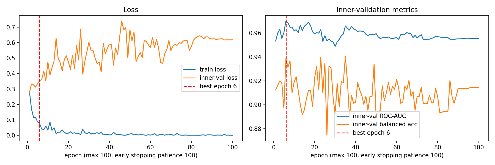
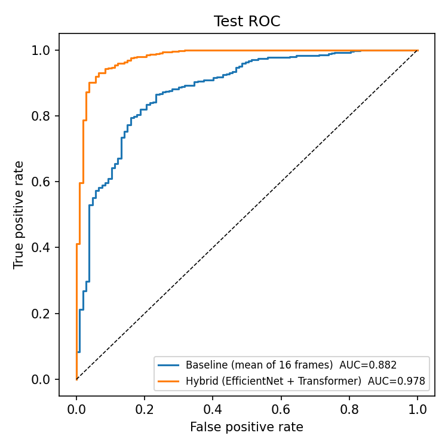
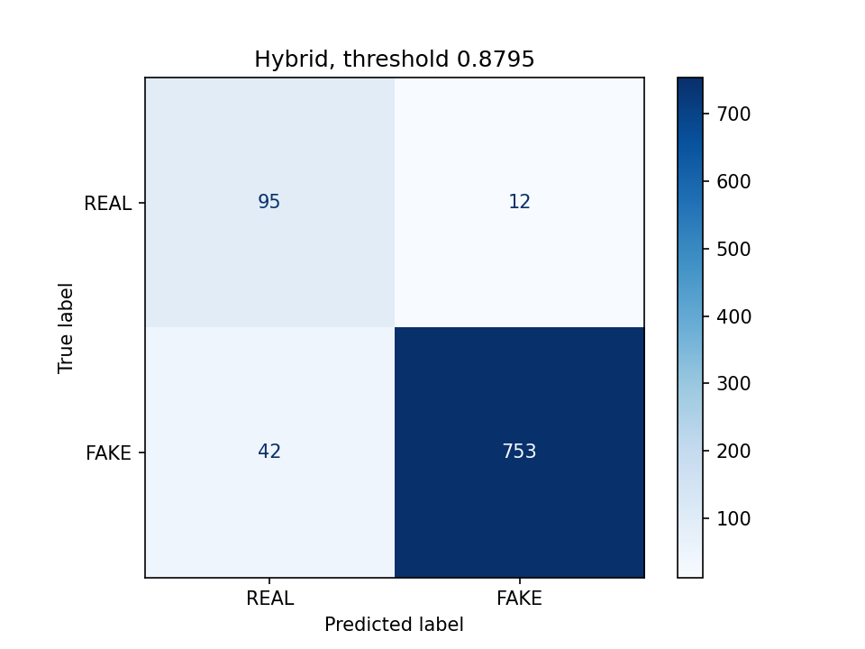
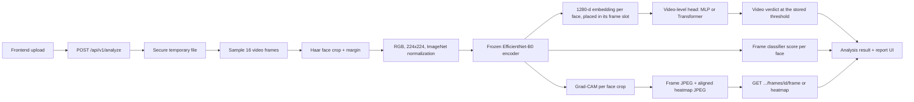

# DeepFake Shield

> **Detect. Localize. Explain. Investigate.**

DeepFake Shield is a forensic analysis platform for digital media authenticity. The **video path is live**: the frontend uploads a video to FastAPI, the backend runs a **two-stage hybrid model** (a frozen EfficientNet-B0 frame encoder plus a learned video-level head), and the result comes back through the analysis and report workflow with **frame-level evidence**: the real sampled frames, the detected face region, and a Grad-CAM heatmap of what drove each frame's score.


---

## Contents

1. [Project status at a glance](#project-status-at-a-glance)
2. [Progress timeline](#progress-timeline)
3. [Feature status](#feature-status)
4. [Model card](#model-card)
5. [Results and ablation](#results-and-ablation)
6. [How the hybrid model was trained](#how-the-hybrid-model-was-trained)
7. [Architecture and inference flow](#architecture-and-inference-flow)
8. [Frame-level explainability](#frame-level-explainability)
9. [Technology stack](#technology-stack)
10. [Repository structure](#repository-structure)
11. [Quick start](#quick-start)
12. [API surface](#api-surface)
13. [Testing and verification status](#testing-and-verification-status)
14. [Known defects](#known-defects)
15. [Known limitations](#known-limitations)
16. [Roadmap](#roadmap)
17. [Dataset and research workflow](#dataset-and-research-workflow)
18. [Project documentation](#project-documentation)

---

## Project status at a glance

_Status as of 2026-10-28, branch `review-hybrid`._

| Area | State | Summary |
| --- | --- | --- |
| **Overall** | 🟢 **Working MVP (video only)** | End-to-end upload → inference → explainable report, safe under concurrent requests |
| Video detection | 🟢 Live | Two-stage hybrid: frozen EfficientNet-B0 frame encoder + mean-pool MLP head over 16 face-cropped frames |
| Model quality | 🟢 Strong on this dataset | Test ROC-AUC **98.86%**, tuned balanced accuracy **94.67%** (baseline: 88.13% / 79.75%) |
| Calibration | 🟡 Weak | Head thresholds are very high (0.8795, 0.9993): the heads are overconfident and uncalibrated |
| Explainability | 🟢 Live | Real per-frame Grad-CAM heatmaps, frame images and face boxes from the frame encoder |
| Frontend | 🟢 Integrated | Upload, processing, dashboard, frame inspector, report, investigations list |
| Backend tests | 🟢 31 / 31 passing | Includes concurrency, failure handling and all three serving modes |
| Concurrency / failure handling | 🟢 Fixed | D1–D3 fixed: inference lock, catch-all → `failed`, guaranteed upload cleanup |
| Frontend quality | 🟡 Clean, untested | 0 TypeScript errors, 0 ESLint errors (10 warnings); **no frontend tests** |
| Image / audio detection | ⚪ Placeholder | Upload contract exists; no trained models |
| Persistence, auth, deployment | ⚪ Not started | In-memory records, no login, no Docker/CI/hosting |

**In one sentence:** an honest, explainable video-deepfake MVP whose served model is a frozen CNN frame encoder with a learned video-level head; it scores very well on this dataset's test split, but its probabilities are uncalibrated and it has not been tested across datasets or identities.

---

## Progress timeline

| Date | Commit | Milestone |
| --- | --- | --- |
| 2026-09-14 | `78a3b18` | Initial commit: Lovable-generated TanStack Start frontend scaffold |
| 2026-09-14 | `67f3fa1` | **Video ML baseline pipeline**: dataset discovery, leakage-checked splits, EfficientNet-B0 training and evaluation scripts, temporal Transformer prototype |
| 2026-09-14 | `48bfbad` | **Frontend integrated with the FastAPI backend** (async upload + polling contract) |
| 2026-09-15 | `7e5c300` | **Trained checkpoint integrated**: real video inference through the web UI |
| 2026-10-24 | `74d8764` | **Frame-level explainability**: Grad-CAM, frame JPEGs, face boxes, artifact endpoint |
| 2026-10-26 | `455216a`, `2647e3f` | **D1–D3 fixed** (inference lock, catch-all failure handling, cleanup) and a traceable evaluation pipeline (`scripts/evaluate_full.py`) |
| 2026-10-26 | `308ead1`, `2522214` | Baseline ablation recorded against a clean commit: 16 frames beat 2 on every test metric |
| 2026-10-26 | `3693e68` | Serving switched to 16 frames at the val-tuned threshold; `DEEPFAKE_FRAMES` / `DEEPFAKE_THRESHOLD` |
| 2026-10-26 | `2799041`, `e801b5a` | Hybrid pipeline: embedding extraction, Colab bundle, head training notebook |
| 2026-10-28 | `f9312a8` | **Hybrid model served**: MLP head by default, Transformer and baseline selectable (`DEEPFAKE_MODEL`) |
| 2026-10-28 | `f9866a1` | Ablation table with Colab and served re-score rows |
| 2026-10-28 | _this commit_ | Documentation updated (this README, technical documentation, viva guide) |

---

## Feature status

| Feature | Status | Where |
| --- | --- | --- |
| Video upload with validation (extension allow-list, magic bytes, 100 MiB cap) | ✅ Complete | `backend/app/main.py` |
| Asynchronous analysis (upload → ID → poll), thread-safe, always reaches `completed` or `failed` | ✅ Complete | `backend/app/main.py`, `backend/app/services/analysis.py` |
| Hybrid video detector (frozen EfficientNet-B0 encoder + MLP / Transformer head), selectable | ✅ Complete | `backend/app/services/video_detector.py`, `ml/models/video_heads.py` |
| Per-frame Grad-CAM heatmaps, frame images, face boxes | ✅ Complete | `video_detector.py`, `GET …/frames/{id}/{frame\|heatmap}` |
| Forensic dashboard, timeline, frame inspector, report page | ✅ Complete for video | `frontend/src/routes/analysis.$id.*.tsx` |
| Health endpoint reporting the active model and threshold (`degraded` if a checkpoint is missing) | ✅ Complete | `GET /health` |
| Dataset audit and leakage-checked splits | ✅ Complete | `ml/data/`, `artifacts/splits/` |
| Traceable evaluation (`metrics.json`, cached predictions, ROC/PR/confusion plots) and ablation table | ✅ Complete | `scripts/evaluate_full.py`, `scripts/make_ablation_table.py`, `artifacts/evaluations/` |
| Embedding extraction and head training on Colab | ✅ Complete | `scripts/extract_embeddings.py`, `notebooks/hybrid_temporal_colab.ipynb` |
| Served-vs-Colab parity check | ✅ Complete | `scripts/check_head_parity.py` |
| Investigations history | 🟡 Partial: in memory, lost on restart | `backend/app/services/repository.py` |
| Image / audio deepfake detection | ⚪ Placeholder (hash-based dummy signals) | `analysis.py::_placeholder_result` |
| Metadata, codec, compression, provenance (C2PA) forensics | ⚪ Not implemented | — |
| Database persistence, authentication, deployment | ⚪ Not implemented | — |

---

## Model card

| Item | Value |
| --- | --- |
| Design | **Two-stage hybrid**: frozen CNN frame encoder → learned video-level head |
| Stage 1: frame encoder | EfficientNet-B0 (ImageNet-pretrained, fine-tuned for real/fake frames), `models/deepfake_shield_video_v1.pt`, frozen; embedding = `avgpool(features(x))` → 1280-d per face crop |
| Stage 2: default head (`mlp`) | Masked mean of the 16 frame embeddings → LayerNorm → Linear(1280→256) → GELU → Dropout(0.2) → Linear(256→2); `models/deepfake_shield_meanpool_mlp_v1.pt` (1.3 MB) |
| Stage 2: alternative head (`temporal`) | LayerNorm + Linear(1280→256), learnable positions, 2-layer pre-norm Transformer encoder (4 heads), masked mean pooling, LayerNorm → Dropout → Linear(256→2); `models/deepfake_shield_temporal_v1.pt` (7.7 MB) |
| Input | 16 evenly spaced frames; largest Haar-cascade face per frame with a 20% margin; RGB `224×224`, ImageNet normalization; frames with no face are masked out |
| Video score | Head softmax fake probability; verdict `FAKE` at or above the head checkpoint's stored threshold |
| Decision thresholds | MLP **0.9993**, Transformer **0.8795**, baseline **0.3654** (all Youden's J on the validation split) |
| Frame-level evidence | Each frame's score comes from the frame encoder's own classifier and is flagged at **0.3654**; the video verdict comes from the head |
| Explainability | Grad-CAM on `features[-1]` of the frame encoder, fake-class logit |
| Device | CUDA when available, otherwise CPU |
| Speed (16 frames + Grad-CAM, median of 5) | About the same in every mode, because the head adds only 0.05 ms (MLP) or 1.1 ms (Transformer): baseline 3.9 s CPU / 0.6 s MPS measured plugged in (2026-10-26); on battery with Low Power Mode (2026-10-28) all modes took 7.0–8.9 s CPU / 1.2–1.3 s MPS. The server itself uses CUDA or CPU, not MPS |
| Configuration | `DEEPFAKE_MODEL` = `mlp` (default) \| `temporal` \| `baseline`; `DEEPFAKE_THRESHOLD` overrides the stored threshold; invalid values stop the server at startup |

---

## Results and ablation

Test split: **902 videos (107 real, 795 fake)**. Thresholds are tuned on validation only; test is used only for reporting. Full table: [`artifacts/evaluations/ablation_table.md`](artifacts/evaluations/ablation_table.md).

| Model | Source | Threshold | Balanced acc. | Real recall | Fake recall | ROC-AUC | PR-AUC |
| --- | --- | --- | ---: | ---: | ---: | ---: | ---: |
| Baseline, 2 frames (mean prob.) | local | 0.2431 | 76.53% | 76.64% | 76.42% | 83.17% | 96.68% |
| **Baseline, 16 frames (mean prob.)** — official baseline | local | 0.3654 | **79.75%** | 86.92% | 72.58% | **88.13%** | 97.89% |
| Baseline, 16 frames: mean / median / top-3 / max | Colab | tuned | 81.55 / 80.88 / 78.61 / 77.72% | — | — | 88.19 / 88.30 / 86.40 / 85.11% | — |
| Hybrid: EfficientNet + Transformer head | Colab | 0.8795 | 91.75% | 88.79% | 94.72% | 97.83% | 99.65% |
| **Hybrid: EfficientNet + mean-pool MLP head** (served) | Colab | 0.9993 | **94.67%** | 96.26% | 93.08% | **98.86%** | 99.83% |
| Hybrid MLP head, re-scored through the served pipeline | local | stored 0.9993 | 94.17% | 96.26% | 92.08% | 98.73% | 99.81% |
| Hybrid Transformer head, re-scored through the served pipeline | local | stored 0.8795 | 91.81% | 88.79% | 94.84% | 97.71% | 99.63% |

**Served-pipeline check.** Re-scoring all 902 val and 902 test videos through the served pipeline (`mlp_served`, `temporal_served`) reproduced test ROC-AUC within 0.15 points (MLP 98.73% vs 98.86%, Transformer 97.71% vs 97.83%); at the stored thresholds, balanced accuracy was 94.17% (MLP; Colab 94.67%) and 91.81% (Transformer; Colab 91.75%). The stored thresholds themselves do not fully reproduce on locally served val scores (MLP 0.9996 vs 0.9993, Transformer 0.9797 vs 0.8795), another sign of saturated, uncalibrated scores.

**Key finding.** Learned aggregation over CNN embeddings raised test **ROC-AUC from 88.13% to 98.86%** and **tuned balanced accuracy from 79.75% to 94.67%** against the local 16-frame baseline. The Colab re-run of the same baseline gave 88.19% / 81.55% (fp16 extraction shifted the tuned threshold from 0.3654 to 0.2917), which is evidence that the baseline reproduces.

**The gain is from learned aggregation, not temporal modelling.** The MLP head ignores frame order entirely, yet it beats the Transformer (98.86% vs 97.83% ROC-AUC). Hand-written aggregations of frame probabilities (mean, median, top-3, max) all stay at 85–88%. So the improvement comes from learning a video-level decision on the 1280-d embeddings rather than averaging frame probabilities. The 16 frames are evenly spaced across the clip, about 1 s apart, which is too sparse to capture short-range temporal artifacts such as flicker or blending jitter; a fair test of temporal modelling needs dense consecutive-frame clips.

**How to read these numbers honestly**

- The dataset is imbalanced (795 fake vs 107 real in test), so accuracy is misleading: always answering "fake" scores 88%. Balanced accuracy and ROC-AUC are the headline metrics.
- With only 107 real test videos, one real video is ~0.9 points of real recall.
- The head thresholds are very high (0.9993 for the MLP), so the heads are overconfident; see [Known limitations](#known-limitations).

---

## How the hybrid model was trained

1. **Embeddings extracted once** on a Colab T4: all 6,011 labelled videos × 16 frames, using exactly the serving preprocessing (`scripts/extract_embeddings.py`, ~3.5 h). Sanity check: the 16-frame mean-probability test ROC-AUC from the Colab embeddings was 0.8819 vs 0.8813 locally.
2. **Heads trained on the frozen embeddings** (the encoder never changes), with the actual configuration stored in both checkpoints:

| Setting | Value |
| --- | --- |
| Epochs | max 100, **no early stopping** (`patience=100`); the kept checkpoint is the epoch with the best inner-val ROC-AUC |
| Inner-val | 15% of train, used only for epoch selection |
| Validation split | used only to tune the decision threshold (Youden's J) |
| Test split | used only for reporting |
| Optimizer | AdamW, lr 3e-4, weight decay 1e-2, cosine LR schedule, batch 64 |
| Regularization | frame dropout 0.25, dropout 0.2 |
| Loss | class-weighted cross-entropy |
| Seed | 42 |

3. **Best epochs.** Transformer: epoch **6** of 100 (inner-val ROC-AUC 0.9699). MLP: epoch **75** of 100 (inner-val ROC-AUC 0.9797; source: Colab cell output, not saved in the checkpoint, see [`mlp_training_note.md`](artifacts/evaluations/hybrid_colab/mlp_training_note.md)).
4. **The Transformer overfits early.** Its inner-val loss is lowest at epoch 1 and rises afterwards (0.277 → 0.618 by epoch 100) while training loss falls to ~0.0005; inner-val ROC-AUC peaks at epoch 6, which is the checkpoint kept.





---

## Architecture and inference flow



- **Frontend** (`frontend/`): React 19 + TanStack Start/Router/Query. Uploads the file, polls the analysis ID, and maps the backend result into the dashboard, timeline, frame inspector, and report (`frontend/src/lib/api.ts`). The report names the active model, e.g. "Video-level decision — EfficientNet-B0 + MLP head"; frame panels are labelled "Frame-level evidence (EfficientNet-B0)".
- **Backend** (`backend/`): FastAPI. Validates and stores the upload, runs analysis as a background task under an inference lock, keeps records in memory, and serves frame artifacts.
- **ML package** (`ml/`, `scripts/`): dataset discovery, splitting, training, evaluation, the shared preprocessing (`ml/data/video_dataset.py`), the frame model (`ml/models/efficientnet_baseline.py`) and the heads (`ml/models/video_heads.py`).

One backbone pass per video gives the embeddings for the head, the frame-classifier scores and the Grad-CAM maps. Frames without a detectable face are masked out; a video with no valid face crop fails cleanly instead of returning a fabricated result. See [`ARCHITECTURE.md`](ARCHITECTURE.md) for diagrams.

---

## Frame-level explainability

Every analyzed frame comes with real evidence:

- **Frame image**: the sampled frame, saved as a JPEG (max width 640 px).
- **Face box**: the padded face crop the model actually saw, in source-video pixels (`[left, top, right, bottom]`).
- **Frame score**: the frame encoder's own classifier output for that face. In head modes this is frame-level evidence; the verdict is a separate video-level decision by the head.
- **Grad-CAM heatmap**: the frame classifier's fake logit back-propagated to `features[-1]`; channel weights are the spatially averaged gradients, the map is ReLU'd, normalized per frame, upsampled to the face crop and colorized (JET) on a black canvas the size of the frame, so it overlays the frame exactly under the UI's screen blend.

Frames are flagged when their frame score is at least **0.3654** (the frame classifier's val-tuned threshold). The head's threshold is not used for frames, because the head's scores live on a different, far less calibrated scale. Severity bands follow the flag: `HIGH` ≥ 75%, `MEDIUM` ≥ 45% or flagged, `LOW` otherwise.

> Grad-CAM shows where the frame classifier's evidence came from; it is an explanation aid, not proof of manipulation. It explains frame scores, not the head's video-level decision.

---

## Screenshots

Captured on 2026-10-28 from the live app (default MLP mode) for one real (`Celeb-real/103.mp4`) and one fake (`Celeb-Youtube-fake/100.mp4`) test video:

| | Real video (Likely Authentic, score 0.516) | Fake video (Likely Manipulated, score >0.999) |
| --- | --- | --- |
| Dashboard | [`real_dashboard.png`](docs/screenshots/real_dashboard.png) | [`fake_dashboard.png`](docs/screenshots/fake_dashboard.png) |
| Frame inspector | [`real_inspector.png`](docs/screenshots/real_inspector.png) | [`fake_inspector.png`](docs/screenshots/fake_inspector.png) |
| Report | [`real_report.png`](docs/screenshots/real_report.png) | [`fake_report.png`](docs/screenshots/fake_report.png) |

The verdict panel shows the video-level score next to the head's decision threshold, with the note that scores are not calibrated probabilities. Scores of 0.9995 or more show as ">99.9%". (The embedded video player is blank in headless captures; frames and heatmaps are real.)

---

## Technology stack

| Layer | Technologies |
| --- | --- |
| Frontend | TypeScript 5.9 (strict), React 19, TanStack Start / Router / React Query, Vite 8, Tailwind CSS 4, Radix UI (shadcn-style), lucide-react, ESLint + Prettier |
| Backend | Python 3.14, FastAPI, Uvicorn, Pydantic v2, python-multipart |
| ML / vision | PyTorch 2.x, torchvision (EfficientNet-B0), OpenCV (decoding, Haar faces, colormaps), NumPy, Pillow, scikit-learn, matplotlib |
| Testing | pytest + `TestClient` (backend); none on the frontend yet |
| Training | Google Colab T4 (encoder fine-tuning, embedding extraction, head training) |

---

## Repository structure

```text
deep-fake/
├── backend/                     FastAPI service
│   ├── app/main.py              routes, upload validation, artifact endpoint, /health
│   ├── app/schemas.py           Pydantic request/response models
│   ├── app/services/
│   │   ├── analysis.py          orchestrates analysis; placeholder image/audio
│   │   ├── video_detector.py    frame encoder, head detectors, Grad-CAM, DEEPFAKE_MODEL factory
│   │   └── repository.py        in-memory analysis store
│   └── tests/                   31 pytest tests
├── frontend/                    React + TanStack Start app
├── ml/
│   ├── data/                    discovery, splits, frame sampling, face cropping
│   └── models/                  efficientnet_baseline.py, video_heads.py, temporal_transformer.py
├── scripts/                     evaluate_full, extract_embeddings, train_temporal_embeddings,
│                                make_ablation_table, check_head_parity, package_for_colab, ...
├── notebooks/                   hybrid_temporal_colab.ipynb
├── models/                      frame encoder + MLP head + Transformer head checkpoints
├── artifacts/
│   ├── splits/                  train / val / test CSVs
│   └── evaluations/             baseline_f2, baseline_f16, hybrid_colab, *_served, ablation_table.md
└── datasets/                    raw/ (gitignored media)
```

---

## Quick start

### 1. Start the backend

```bash
cd backend
python3 -m venv .venv
source .venv/bin/activate
python3 -m pip install -r requirements.txt
python -m uvicorn app.main:app --reload
```

The API runs at `http://127.0.0.1:8000`; OpenAPI docs are at `/docs`. Use `python -m uvicorn` rather than bare `uvicorn` so the venv's interpreter is used.

Choose the serving model with environment variables:

```bash
DEEPFAKE_MODEL=mlp       python -m uvicorn app.main:app   # default: EfficientNet-B0 + MLP head
DEEPFAKE_MODEL=temporal  python -m uvicorn app.main:app   # EfficientNet-B0 + Transformer head
DEEPFAKE_MODEL=baseline  python -m uvicorn app.main:app   # mean frame probability, 16 frames @ 0.3654
DEEPFAKE_THRESHOLD=0.95  python -m uvicorn app.main:app   # override the stored threshold
```

`DEEPFAKE_MODEL_PATH` points at another frame encoder and `DEEPFAKE_HEAD_PATH` at another head checkpoint. Head modes require 16 frames.

### 2. Start the frontend

```bash
cd frontend
npm install
npm run dev
```

The frontend defaults to `http://127.0.0.1:8000` (override with `VITE_API_BASE_URL` in `frontend/.env.local`, then restart). Mock mode is opt-in: `VITE_USE_MOCK_DATA=true npm run dev`.

### 3. Upload a video

```bash
curl -X POST http://127.0.0.1:8000/api/v1/analyze -F "file=@datasets/raw/test/00272.mp4"
curl http://127.0.0.1:8000/api/v1/analyze/DF-YYYYMMDD-XXXXXXXX
curl http://127.0.0.1:8000/health
```

`/health` reports the active model:

```json
{
	"status": "ok",
	"service": "deepfake-shield-api",
	"inference_mode": "efficientnet_b0_meanpool_mlp",
	"model": "EfficientNet-B0 + MLP head",
	"decision_threshold": 0.9992828965187073
}
```

The analysis result shape is unchanged: `verdict`, `confidence`, `fake_probability`, `real_probability`, `frames_analyzed` and `frame_scores[]` (frame id, timestamp, frame-level `fake_probability`, `face_box`, `thumbnail_url`, `heatmap_url`). In head modes, `fake_probability` is the head's video-level score and each `frame_scores[].fake_probability` is the frame classifier's score. Each result also records the `model_name`, `decision_threshold` and `frame_threshold` it was produced with (added fields; nothing was removed or renamed).

---

## API surface

| Method | Path | Purpose |
| --- | --- | --- |
| `POST` | `/api/v1/analyze` | Upload an image, video, or audio file; returns an analysis ID |
| `GET` | `/api/v1/analyze` | List analyses (investigations history) |
| `GET` | `/api/v1/analyze/{analysis_id}` | Poll status and retrieve the result |
| `GET` | `/api/v1/analyze/{analysis_id}/evidence` | Evidence signals |
| `GET` | `/api/v1/analyze/{analysis_id}/report` | Report payload |
| `GET` | `/api/v1/analyze/{analysis_id}/frames/{frame_id}/{frame\|heatmap}` | Analyzed frame or its Grad-CAM heatmap (JPEG) |
| `GET` | `/health` | Service status, inference mode, active model and decision threshold (`degraded` if a checkpoint is missing) |

The analysis response shape is unchanged across serving modes.

---

## Testing and verification status

| Check | Result | Last run |
| --- | --- | --- |
| Backend tests (`cd backend && python -m pytest -q`) | ✅ **31 passed** | 2026-10-28 |
| TypeScript (`npx tsc --noEmit`) | ✅ 0 errors | 2026-10-28 |
| ESLint (`npm run lint`) | ✅ 0 errors, ⚠️ 10 warnings (`react-refresh/only-export-components`) | 2026-10-28 |
| 4-thread concurrency test | ✅ identical scores | 2026-10-28 |
| Served pipeline vs Colab test metrics (902 videos) | ✅ ROC-AUC within 0.15 points of Colab for both heads (MLP 98.71 vs 98.86, Transformer 97.71 vs 97.83) | 2026-10-28 |
| Real-video upload through the API (`TestClient`, default MLP mode) | ✅ completed, artifacts served | 2026-10-28 |

The tests cover model and head loading (strict state-dict match for both heads), inference on a real video in every `DEEPFAKE_MODEL` mode, stored vs overridden thresholds, invalid configuration rejected at startup, concurrency, unexpected-error handling and cleanup, no-face handling, Grad-CAM artifacts and the artifact endpoints.

**Coverage gaps:** no frontend tests, no end-to-end browser test, and some tests depend on an untracked local video (D7).

---

## Known defects

D1–D3 (concurrency crashes, score drift, analyses stuck in `processing`) are **fixed** and covered by tests. D4 (navbar reads `/health`: Online / Degraded / Offline) and D9 (coverage shown as COMPLETE in green; verdict coloured by meaning) were fixed on 2026-10-28, and coverage is now mapped by signal name (part of D5).

| # | Severity | Defect | Fix |
| --- | --- | --- | --- |
| D5 | ⚪ Low | Non-coverage evidence IDs still assigned by position | Map every signal by name |
| D6 | 🟡 Medium | "Faces detected" shows `frames_analyzed` | Return the real face count |
| D7 | 🟡 Medium | Some tests depend on an untracked local video, so a fresh clone skips or fails them | Commit a small licensed fixture |
| D8 | ⚪ Low | `ml/training/train_efficientnet.py` is legacy and broken | Delete or mark legacy |

Other risks: no authentication, `torch.load(weights_only=False)` on checkpoint paths, no rate limit or inference timeout, and the startup `rmtree` of the artifact folder is unsafe with multiple workers.

---

## Known limitations

- **Uncalibrated, overconfident heads.** The val-tuned thresholds are 0.8795 (Transformer) and 0.9993 (MLP), so a "fake probability" of 0.99 can still mean *real*. Temperature scaling on validation would fix the scale without changing the ranking.
- **The frame encoder was fine-tuned on only ~1,000 of the 4,207 training videos** (inferred from the checkpoint metadata; the run is not recorded), then frozen.
- **Splits are by file, not identity.** Celeb-DF reuses the same celebrities across videos, so identity leakage between train and test is possible and the scores may be optimistic.
- **Small real class:** 107 real test videos.
- **One dataset family** (Celeb-DF style); cross-dataset generalization is untested.
- **Sparse sampling:** 16 evenly spaced frames, about 1 s apart, so short-range temporal artifacts are invisible to both heads.
- **Grad-CAM explains frame scores, not the head's decision.**
- **In-memory storage and temporary artifacts**: restarting the backend clears all analyses; uploads are deleted after analysis.
- **Image and audio** return placeholder signals.
- **External drives**: on FAT32/exFAT, macOS creates `._*` files that break imports and ESLint; clean with `dot_clean -m .`.

---

## Roadmap

**Next**

1. Temperature scaling (or Platt scaling) of the heads on validation; report calibration curves.
2. Identity-aware re-split and re-evaluation.
3. Dense consecutive-frame clips (e.g. 16 frames at full frame rate) to test whether temporal modelling helps at all.
4. Fine-tune the encoder on the full training split; cross-dataset evaluation (FaceForensics++, DFDC).
5. A small committed fixture video so all tests run on a clean clone (D7); fix D5–D6.

**Later**

- SQLite/PostgreSQL persistence and durable artifact storage; authentication.
- Frontend tests (Vitest, Playwright), ruff + mypy, CI.
- Real image and audio detectors; metadata, compression and C2PA provenance analysis.

---

## Dataset and research workflow

The workspace holds **6,529** readable `.mp4` videos under `datasets/raw/` in a Celeb-DF-style layout:

| Folder | Videos | Label |
| --- | ---: | --- |
| `Celeb-Youtube-fake` | 5,299 | fake |
| `Celeb-real` | 482 | real |
| `YouTube-real` | 230 | real |
| `test` | 518 | unlabeled |

Labeled videos (6,011) are split into train / val / test = **4,207 / 902 / 902** (`artifacts/splits/*.csv`), grouped by file hash and stratified by class. Raw data and splits are never modified.

```bash
# Baseline evaluation through the serving pipeline (cached, resumable)
backend/.venv/bin/python scripts/evaluate_full.py --checkpoint models/deepfake_shield_video_v1.pt \
    --frames 16 --out-dir artifacts/evaluations/baseline_f16

# Served head evaluation (val + test, stored and re-tuned thresholds)
backend/.venv/bin/python scripts/evaluate_full.py --model mlp --checkpoint models/deepfake_shield_video_v1.pt \
    --frames 16 --out-dir artifacts/evaluations/mlp_served

# Served vs Colab parity on 20 test videos, and the ablation table
backend/.venv/bin/python scripts/check_head_parity.py --models mlp temporal
backend/.venv/bin/python scripts/make_ablation_table.py
```

Related public datasets: [Celeb-DF](https://github.com/yuezunli/celeb-deepfakeforensics), [DFDC](https://www.kaggle.com/c/deepfake-detection/data), [Real and Fake Face Detection](https://www.kaggle.com/datasets/ciplab/real-and-fake-face-detection).

---

## Project documentation

| Document | Contents |
| --- | --- |
| [`PROJECT_TECHNICAL_DOCUMENTATION.md`](PROJECT_TECHNICAL_DOCUMENTATION.md) | Full codebase, algorithms, evidence, defects and roadmap |
| [`ARCHITECTURE.md`](ARCHITECTURE.md) | System and data-flow diagrams |
| [`PROJECT_REVIEW_AND_VIVA_GUIDE.md`](PROJECT_REVIEW_AND_VIVA_GUIDE.md) | Review and viva preparation, likely questions and answers |
| [`artifacts/evaluations/ablation_table.md`](artifacts/evaluations/ablation_table.md) | Every evaluated run on the test split |
| [`artifacts/evaluations/hybrid_colab/`](artifacts/evaluations/hybrid_colab/) | Colab metrics, training history and plots for the heads |
