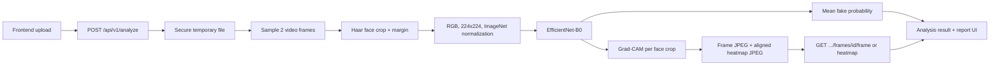

# DeepFake Shield

> **Detect. Localize. Explain. Investigate.**

DeepFake Shield is a forensic analysis platform for digital media authenticity. The **video path is live**: the frontend uploads a video to FastAPI, the backend runs a trained EfficientNet-B0 checkpoint, and the result comes back through the analysis and report workflow with **frame-level evidence**: the real sampled frames, the detected face region, and a Grad-CAM heatmap of what drove each frame's score.


---

## Contents

1. [Project status at a glance](#project-status-at-a-glance)
2. [Progress timeline](#progress-timeline)
3. [Feature status](#feature-status)
4. [Model card and results](#model-card-and-results)
5. [Architecture and inference flow](#architecture-and-inference-flow)
6. [Frame-level explainability](#frame-level-explainability)
7. [Technology stack](#technology-stack)
8. [Repository structure](#repository-structure)
9. [Quick start](#quick-start)
10. [API surface](#api-surface)
11. [Testing and verification status](#testing-and-verification-status)
12. [Known defects (open)](#known-defects-open)
13. [Known limitations](#known-limitations)
14. [Roadmap](#roadmap)
15. [Dataset and research workflow](#dataset-and-research-workflow)
16. [Project documentation](#project-documentation)

---

## Project status at a glance

_Status as of 2026-10-26, commit `236785b` plus the uncommitted documentation files._

| Area | State | Summary |
| --- | --- | --- |
| **Overall** | 🟢 **Working MVP (video only)** | End-to-end upload → inference → explainable report works locally for one user at a time |
| Video detection | 🟢 Live | EfficientNet-B0, 2 face-cropped frames per video, ~0.8 s per video on CPU (Apple M4) |
| Explainability | 🟢 Live | Real per-frame Grad-CAM heatmaps, frame images, and face boxes, served over the API |
| Frontend | 🟢 Integrated | Upload, processing, dashboard, frame inspector, report, investigations list |
| Backend tests | 🟢 13 / 13 passing | Re-run on 2026-10-26 (`pytest -q`, 12 s) |
| Frontend quality | 🟡 Clean, untested | 0 TypeScript errors, 0 ESLint errors (10 warnings); **no frontend tests** |
| Model quality | 🟡 Weak operating point | ROC-AUC ≈ 0.83, but 55% accuracy at the 0.5 threshold; uncalibrated |
| Concurrency | 🔴 Not safe | Simultaneous analyses can crash or return wrong scores (D1, D2) |
| Failure handling | 🔴 Gap | Unexpected errors leave analyses stuck in `processing` (D3) |
| Image / audio detection | ⚪ Placeholder | Upload contract exists; no trained models |
| Persistence, auth, deployment | ⚪ Not started | In-memory records, no login, no Docker/CI/hosting |

**In one sentence:** a credible, honest, explainable video-deepfake MVP that runs well for a single local user; it is not yet production-ready, and the model's decision threshold needs tuning before its verdicts can be trusted.

---

## Progress timeline

| Date | Commit | Milestone |
| --- | --- | --- |
| 2026-09-14 | `78a3b18` | Initial commit: Lovable-generated TanStack Start frontend scaffold |
| 2026-09-14 | `93a258f` | Dataset links added to the README |
| 2026-09-14 | `67f3fa1` | **Video ML baseline pipeline**: dataset discovery, leakage-checked splits, EfficientNet-B0 training and evaluation scripts, temporal Transformer prototype |
| 2026-09-14 | `28b5a4e` | Google Colab training workflow (`docs/colab_video_training.md`) |
| 2026-09-14 | `48bfbad` | **Frontend integrated with the FastAPI backend** (async upload + polling contract) |
| 2026-09-14 | `61b7d2e`, `5c2374b` | Mock banner hidden in backend mode; Lovable branding removed |
| 2026-09-15 | `7e5c300` | **Trained checkpoint integrated**: real video inference through the web UI |
| 2026-09-24 | `e551893` | Integration bug fixes (env/port, venv `uvicorn`, real media previews) |
| 2026-10-24 | `74d8764` | **Frame-level explainability**: Grad-CAM, frame JPEGs, face boxes, artifact endpoint, real Suspicious Frames UI, 2 new tests |
| 2026-10-24 | `236785b` | macOS `._*` AppleDouble files ignored and untracked |
| 2026-10-24 | _uncommitted_ | Review documents: `PROJECT_TECHNICAL_DOCUMENTATION.md`, `ARCHITECTURE.md`, `PROJECT_REVIEW_AND_VIVA_GUIDE.md` |
| 2026-10-26 | _uncommitted_ | This README rewritten as a full status report |

---

## Feature status

| Feature | Status | Where |
| --- | --- | --- |
| Video upload with validation (extension allow-list, magic bytes, 100 MiB cap) | ✅ Complete | `backend/app/main.py` |
| Asynchronous analysis (upload → ID → poll) | ✅ Complete | `backend/app/main.py`, `backend/app/services/analysis.py` |
| Video deepfake inference (EfficientNet-B0, face crops) | ✅ Complete | `backend/app/services/video_detector.py` |
| Per-frame Grad-CAM heatmaps, frame images, face boxes | ✅ Complete | `video_detector.py`, `GET …/frames/{id}/{frame\|heatmap}` |
| Forensic dashboard, timeline, frame inspector, report page | ✅ Complete for video | `frontend/src/routes/analysis.$id.*.tsx` |
| Evidence and report endpoints | ✅ Complete | `/evidence`, `/report` |
| Health endpoint with `degraded` mode when the checkpoint is missing | ✅ Complete | `GET /health` |
| Mock / demo mode (opt-in) | ✅ Complete | `VITE_USE_MOCK_DATA=true`, `frontend/src/lib/mockData.ts` |
| Dataset audit and leakage-checked splits | ✅ Complete | `ml/data/dataset_discovery.py`, `ml/data/split_dataset.py`, `artifacts/splits/` |
| Training and evaluation pipeline | ✅ Code complete; trained offline (Colab) | `scripts/train_baseline.py`, `scripts/evaluate_baseline.py` |
| Investigations history | 🟡 Partial: in memory, lost on restart | `backend/app/services/repository.py`, `routes/investigations.tsx` |
| Temporal Transformer over frame embeddings | 🟡 Experimental: one 12-video sanity run, not served | `ml/models/temporal_transformer.py`, `scripts/train_temporal.py` |
| Image deepfake detection | ⚪ Placeholder (hash-based dummy signals) | `analysis.py::_placeholder_result` |
| Audio deepfake detection | ⚪ Placeholder | same |
| Metadata, codec, compression, provenance (C2PA) forensics | ⚪ Not implemented (UI shows "Not available") | — |
| Database persistence | ⚪ Not implemented (`DATABASE_URL` in `.env.example` is unused) | — |
| Authentication / multi-user | ⚪ Not implemented | — |
| Deployment (Docker, CI, hosting) | ⚪ Not implemented | — |

---

## Model card and results

| Item | Value |
| --- | --- |
| Architecture | EfficientNet-B0 (ImageNet-pretrained backbone, 2-class head) |
| Framework | PyTorch |
| Parameters / size | 4,010,110 parameters, 16.3 MB checkpoint |
| Input | Face crop (Haar cascade + margin), RGB, `224x224`, ImageNet normalization |
| Frames per video (serving) | 2 evenly sampled frames; video score = mean fake probability |
| Classes | `REAL` / `FAKE` |
| Checkpoint | `models/deepfake_shield_video_v1.pt` (override with `DEEPFAKE_MODEL_PATH`) |
| Decision threshold | `0.5` fake probability |
| Device | CUDA when available, otherwise CPU |
| Explainability | Grad-CAM on `features[-1]`, fake-class logit |
| Speed | Model load 2.2 s; median 0.81 s per video (2 frames + Grad-CAM, CPU, Apple M4) |

### Results

| Source | Split | Accuracy | Precision | Recall | F1 | ROC-AUC | PR-AUC |
| --- | --- | ---: | ---: | ---: | ---: | ---: | ---: |
| Reported test-set results | test (902 videos) | **55.43%** | **97.35%** | **50.82%** | **66.78%** | **83.01%** | **96.79%** |
| Metadata stored in the checkpoint (epoch 2) | validation (902) | 59.53% | 97.15% | 55.72% | 70.82% | 82.31% | 96.74% |

How to read these numbers honestly:

- **The model ranks well but decides poorly.** ROC-AUC 0.83 means a random fake scores higher than a random real video about 83% of the time, but at the 0.5 threshold half of the fakes are missed.
- **The dataset is imbalanced** (795 fake vs 107 real in test), so always answering "fake" would score 88% accuracy. Accuracy alone is misleading here; ROC-AUC and per-class recall matter more.
- **Traceability gap:** the test-set file that produced the first row is not committed. The numbers are internally consistent with the repository's test split (TP 404, FP 11, TN 96), and were most likely produced by `scripts/evaluate_baseline.py` (16 frames, full-frame fallback), not the 2-frame serving path.
- `confidence` is the selected class probability. It is **not calibrated** and is not legal certainty.

---

## Architecture and inference flow



Three parts:

- **Frontend** (`frontend/`): React 19 + TanStack Start/Router/Query. Uploads the file, polls the analysis ID, and maps the backend result into the dashboard, timeline, frame inspector, and report (`frontend/src/lib/api.ts`).
- **Backend** (`backend/`): FastAPI. Validates and stores the upload, runs analysis as a background task, keeps records in memory, and serves frame artifacts.
- **ML package** (`ml/`, `scripts/`): dataset discovery, splitting, training, evaluation, and the shared preprocessing (`ml/data/video_dataset.py`) and model definition (`ml/models/efficientnet_baseline.py`) that the backend reuses, so serving matches training.

Frames without a detectable face are skipped; a video with no valid face crop fails cleanly instead of returning a fabricated result. See [`ARCHITECTURE.md`](ARCHITECTURE.md) for full diagrams.

---

## Frame-level explainability

Every analyzed frame comes with real evidence instead of placeholder visuals:

- **Frame image**: the sampled frame, saved as a JPEG (max width 640 px).
- **Face box**: the padded face crop the model actually saw, in source-video pixels (`[left, top, right, bottom]`).
- **Grad-CAM heatmap**: computed in the same forward pass as the prediction (scores are identical to the plain `no_grad` path: 0.020694 vs 0.020694 on `00272.mp4`). The fake-class logit is back-propagated to `features[-1]`; channel weights are the spatially averaged gradients, the map is ReLU'd, normalized per frame, upsampled to the face crop, colorized (JET), and placed on a black canvas the size of the frame. Black areas vanish under the UI's screen blend, so the heatmap overlays the frame exactly.

In the UI, the **Suspicious Frames** section lists every analyzed frame (highest score first), with:

- the real thumbnail and face box, outlined red when the frame is above the decision threshold;
- the true source frame number and timestamp;
- a severity band matching the timeline colours: `HIGH` ≥ 75%, `MEDIUM` ≥ 45%, `LOW` below that;
- an inspector with the original frame, an adjustable Grad-CAM overlay labelled `GRAD-CAM · EFFICIENTNET-B0`, the frame score, the flagged region, and a plain-language explanation.

The "Suspicious regions" summary counts only frames the detector actually flagged (fake probability ≥ `0.5`). Mock mode keeps the demo heatmap with its "Demonstration visualisation" disclaimer.

> Grad-CAM shows where the model's evidence came from; it is an explanation aid, not proof of manipulation. On authentic videos the attention is usually weak and diffuse, which is expected.

---

## Technology stack

| Layer | Technologies |
| --- | --- |
| Frontend | TypeScript 5.9 (strict), React 19, TanStack Start / Router / React Query, Vite 8, Tailwind CSS 4, Radix UI (shadcn-style), lucide-react, ESLint + Prettier |
| Backend | Python 3.14, FastAPI, Uvicorn, Pydantic v2, python-multipart |
| ML / vision | PyTorch 2.x, torchvision (EfficientNet-B0), OpenCV (decoding, Haar faces, colormaps), NumPy, Pillow, scikit-learn (metrics) |
| Testing | pytest + httpx `TestClient` (backend); none on the frontend yet |
| Training | Google Colab GPU (`docs/colab_video_training.md`) |

The frontend scaffold was generated with Lovable (`tanstack_start_ts_current` template) and then integrated with the real backend.

---

## Repository structure

```text
deep-fake/
├── backend/                  FastAPI service
│   ├── app/main.py           routes, upload validation, artifact endpoint
│   ├── app/schemas.py        Pydantic request/response models
│   ├── app/services/
│   │   ├── analysis.py       orchestrates analysis, placeholder image/audio
│   │   ├── video_detector.py EfficientNet-B0 inference + Grad-CAM
│   │   └── repository.py     in-memory analysis store
│   └── tests/                13 pytest tests
├── frontend/                 React + TanStack Start app
│   └── src/
│       ├── routes/           pages: analyze, processing, dashboard, report, investigations, about
│       ├── components/       analysis, upload, layout, ui primitives
│       └── lib/api.ts        backend contract, polling, result mapping, mock mode
├── ml/                       data, models, training, evaluation, inference
├── scripts/                  CLI entry points (inspect, split, train, evaluate, infer)
├── models/                   deepfake_shield_video_v1.pt (served checkpoint)
├── artifacts/                dataset report, splits, experiments, evaluations
├── datasets/                 raw/ and processed/ (gitignored media)
├── docs/                     Colab training guide
└── *.md                      README, architecture, technical docs, review guides
```

---

## Quick start

### 1. Start the backend

From the repository root:

```bash
cd backend
python3 -m venv .venv
source .venv/bin/activate
python3 -m pip install -r requirements.txt
python -m uvicorn app.main:app --reload
```

The API runs at `http://127.0.0.1:8000`; OpenAPI docs are at `http://127.0.0.1:8000/docs`.

> Use `python -m uvicorn` rather than bare `uvicorn`. With a global Python install, zsh can keep running the global `uvicorn` even after the venv is activated, which fails with `ModuleNotFoundError: No module named 'fastapi'`. Running `rehash` after activating also fixes it.

To use another checkpoint without changing code:

```bash
DEEPFAKE_MODEL_PATH=/absolute/path/to/model.pt python -m uvicorn app.main:app --reload
```

### 2. Start the frontend

In a second terminal:

```bash
cd frontend
npm install
npm run dev
```

The frontend defaults to `http://127.0.0.1:8000`. Override it with `VITE_API_BASE_URL` in `frontend/.env.local` and restart `npm run dev` afterwards (Vite reads env files only at startup). Use `127.0.0.1` rather than `localhost` so requests can't land on another service (for example a Docker container) on the same port. Mock mode is opt-in:

```bash
VITE_USE_MOCK_DATA=true npm run dev
```

### 3. Upload a real video

```bash
curl -X POST http://127.0.0.1:8000/api/v1/analyze \
	-F "file=@datasets/raw/test/00272.mp4"
```

The endpoint returns an analysis ID immediately. Poll it:

```bash
curl http://127.0.0.1:8000/api/v1/analyze/DF-YYYYMMDD-XXXXXXXX
```

The video result includes the aggregate prediction and per-frame evidence:

```json
{
	"verdict": "likely_authentic",
	"confidence": 0.941162,
	"fake_probability": 0.058838,
	"real_probability": 0.941162,
	"frames_analyzed": 2,
	"frame_scores": [
		{
			"frame_id": 0,
			"timestamp": 0.0,
			"fake_probability": 0.020694,
			"face_box": [344, 32, 498, 186],
			"thumbnail_url": "/api/v1/analyze/DF-YYYYMMDD-XXXXXXXX/frames/0/frame",
			"heatmap_url": "/api/v1/analyze/DF-YYYYMMDD-XXXXXXXX/frames/0/heatmap"
		}
	]
}
```

Fetch a frame image or its heatmap (both `image/jpeg`):

```bash
curl -o frame.jpg   http://127.0.0.1:8000/api/v1/analyze/DF-YYYYMMDD-XXXXXXXX/frames/0/frame
curl -o heatmap.jpg http://127.0.0.1:8000/api/v1/analyze/DF-YYYYMMDD-XXXXXXXX/frames/0/heatmap
```

---

## API surface

| Method | Path | Purpose |
| --- | --- | --- |
| `POST` | `/api/v1/analyze` | Upload an image, video, or audio file; returns an analysis ID |
| `GET` | `/api/v1/analyze` | List analyses (investigations history) |
| `GET` | `/api/v1/analyze/{analysis_id}` | Poll status and retrieve the result |
| `GET` | `/api/v1/analyze/{analysis_id}/evidence` | Evidence signals |
| `GET` | `/api/v1/analyze/{analysis_id}/report` | Report payload |
| `GET` | `/api/v1/analyze/{analysis_id}/frames/{frame_id}/{frame\|heatmap}` | Analyzed frame or its Grad-CAM heatmap (JPEG; `404` for unknown analyses or frames) |
| `GET` | `/health` | Service status and inference mode (`degraded` if the checkpoint is missing) |

No duplicate `/predict` endpoint exists; the frontend uses the upload-and-poll contract in `frontend/src/lib/api.ts`.

---

## Testing and verification status

| Check | Result | Last run |
| --- | --- | --- |
| Backend tests (`cd backend && python -m pytest -q`) | ✅ **13 passed** in 12 s | 2026-10-26 |
| TypeScript (`npx tsc --noEmit`) | ✅ 0 errors | 2026-10-24 |
| ESLint (`npm run lint`) | ✅ 0 errors, ⚠️ 10 warnings (`react-refresh/only-export-components`) | 2026-10-24 |
| Live API round trip (upload → completed → artifacts `200 image/jpeg`) | ✅ Passed | 2026-10-24 |
| Grad-CAM leaves scores unchanged | ✅ 0.020694 vs 0.020694 | 2026-10-24 |
| 4-thread concurrency test | ❌ Crashes and score drift (see D1, D2) | 2026-10-24 |

The 13 backend tests cover model loading, CPU execution, face extraction, preprocessing, real-video inference, API upload, response fields, no-face handling, Grad-CAM and frame-artifact generation (matching sizes, valid face boxes), and serving those artifacts, including `404`s.

**Coverage gaps:** no frontend tests, no end-to-end browser test, no tests for concurrency, unexpected exceptions, missing checkpoint, oversized (413) or empty (400) uploads, or the training scripts. No Python linter or type checker is configured.

Other checks you can run:

```bash
# Direct inference without the API
python3 scripts/infer_video.py \
	--video datasets/raw/test/00272.mp4 \
	--checkpoint models/deepfake_shield_video_v1.pt \
	--frames 2

# Frontend lint and build
cd frontend && npm run lint && npm run build
```

---

## Known defects (open)

| # | Severity | Defect | Fix |
| --- | --- | --- | --- |
| D1 | 🔴 High | **Concurrent analyses are not thread-safe.** The Grad-CAM hook on the shared model captures another request's activations (`AttributeError` at `video_detector.py:164`; wrong scores in 15 of 48 runs) | Wrap `VideoDetector.predict` in a `threading.Lock` |
| D2 | 🔴 High | Score drift under concurrency even without Grad-CAM (likely the shared `cv2.CascadeClassifier`) | Same lock, or one `FaceCropper` per thread |
| D3 | 🔴 High | `AnalysisService.run` only catches `OSError` / `VideoInferenceError`; anything else leaves the record stuck in `processing` (frontend polls forever) and skips upload cleanup | Catch `Exception` → `FAILED`; `try/finally` for cleanup |
| D4 | 🟡 Medium | Navbar "System Status: Online" is hard-coded | Read `/health` |
| D5 | 🟡 Medium | Evidence IDs assigned by position (face coverage is tagged `compression`) | Map by signal name |
| D6 | 🟡 Medium | "Faces detected" shows `frames_analyzed` | Return the real face count |
| D7 | 🟡 Medium | Five tests depend on an untracked local video, so a fresh clone or CI fails | Commit a small licensed fixture |
| D8 | ⚪ Low | `ml/training/train_efficientnet.py` is legacy and broken (missing `tqdm`, 1-logit head) | Delete or mark legacy |

Other risks noted in review: no authentication (anyone on the port can list analyses), `torch.load(weights_only=False)` on the checkpoint path, `validate_signature` reads the whole file to check 16 bytes, no rate limit or inference timeout, and startup `rmtree` of the artifact folder is unsafe with multiple workers.

---

## Known limitations

- **In-memory storage**: restarting the backend (including an automatic `--reload`) clears all analyses; old IDs return `404`.
- **Temporary frame artifacts**: written to the system temp directory (`deepfake-shield-artifacts/`) and wiped on startup.
- **Original media is not kept**: the upload is deleted after analysis, so the video/image preview works only in the tab that uploaded it; after a reload the viewer shows "Preview unavailable" (frames and heatmaps still load).
- **Two sampled frames** per video (`DEFAULT_FRAMES` in `video_detector.py`), so at most two suspicious-frame entries.
- **Threshold and calibration**: 0.5 is too conservative for this class balance; confidence is uncalibrated.
- **Possible identity leakage**: local files are renamed to integers, so splits are grouped by file hash, not by person identity.
- **Single process only**: state is per-process, so multiple Uvicorn workers would not share records.
- **Image and audio** return placeholder signals.
- **External drives**: on exFAT, macOS creates `._*` files that cause pip `Ignoring invalid distribution` warnings, ESLint parse errors, and git pack warnings. Harmless; clean with `dot_clean -m .`.

---

## Roadmap

**Essential (before any multi-user demo)**

1. Fix D1/D2 with an inference lock and re-run the concurrency test.
2. Fix D3 with catch-all failure handling and guaranteed cleanup, plus a test.
3. Make the reported test metrics traceable to a committed `test_metrics.json` produced by the serving pipeline.
4. Add a small fixture video so the tests run on a clean clone (D7).

**Important**

5. Choose the threshold on validation data (Youden J or target FPR); add a confusion matrix and calibration (temperature scaling).
6. More frames (8–16) and better aggregation (mean vs max vs top-k).
7. Identity-aware splits.
8. Return an explicit "unsupported" for image/audio instead of placeholder scores.
9. SQLite/PostgreSQL persistence and durable artifact storage.
10. Fix D4–D6; update `.env.example` (add `DEEPFAKE_MODEL_PATH`, drop unused variables).
11. Remove dead code (`ml/explainability/gradcam.py`, `ml/training/train_efficientnet.py`).
12. Frontend tests (Vitest + React Testing Library, Playwright end-to-end), ruff + mypy, CI.

**Future**

- Train and serve the temporal Transformer.
- Real image and audio detectors.
- Metadata/codec (ffprobe), compression (ELA, double compression), and C2PA provenance analysis.
- Evidence fusion, authentication, case management, and containerized GPU deployment.

---

## Dataset and research workflow

The workspace holds **6,529** readable `.mp4` videos under `datasets/raw/` (none corrupted), in a Celeb-DF-style layout:

| Folder | Videos | Label |
| --- | ---: | --- |
| `Celeb-Youtube-fake` | 5,299 | fake |
| `Celeb-real` | 482 | real |
| `YouTube-real` | 230 | real |
| `test` | 518 | unlabeled |

Labeled videos (6,011) are split into train / val / test = **4,207 / 902 / 902** (`artifacts/splits/*.csv`), grouped by file hash and stratified by class. Raw data is never modified; generated reports, splits, experiments, and evaluations go under `artifacts/`.

Experiments on record (`artifacts/experiments/`): `sanity_baseline`, `batch_001_baseline` (untrained, predicts all-fake), `batch_002_pretrained`, `batch_003_pretrained_500`, and `sanity_temporal`. The served checkpoint was trained on Colab.

```bash
python3 scripts/inspect_dataset.py
python3 scripts/split_dataset.py

# Bounded training sanity check
python3 scripts/train_baseline.py --epochs 1 --limit 20 --frames-per-video 4
python3 scripts/evaluate_baseline.py --checkpoint artifacts/experiments/<run>/best_model.pt
```

Research safeguards:

- Split at the video or source level, never at the frame level.
- Keep model confidence separate from the broader forensic assessment.
- Treat Grad-CAM as an explanation aid, not proof of manipulation.
- Review dataset licenses before downloading or redistributing media.

Related public datasets:

- [Celeb-DF](https://github.com/yuezunli/celeb-deepfakeforensics): matches the local folder layout.
- [Deepfake Detection Challenge dataset](https://www.kaggle.com/c/deepfake-detection/data): video deepfake detection data.
- [Real and Fake Face Detection dataset](https://www.kaggle.com/datasets/ciplab/real-and-fake-face-detection): real/fake face image data.

---

## Project documentation

| Document | Contents |
| --- | --- |
| [`PROJECT_TECHNICAL_DOCUMENTATION.md`](PROJECT_TECHNICAL_DOCUMENTATION.md) | Full codebase, stack, algorithms, evidence, defects, and roadmap (2026-10-24) |
| [`ARCHITECTURE.md`](ARCHITECTURE.md) | System and data-flow diagrams |
| [`PROJECT_REVIEW_AND_VIVA_GUIDE.md`](PROJECT_REVIEW_AND_VIVA_GUIDE.md) | Review and viva preparation, likely questions and answers |
| [`PROJECT_REVIEW.md`](PROJECT_REVIEW.md) | Earlier review (2026-09-24); its Grad-CAM section is now outdated |
| [`docs/colab_video_training.md`](docs/colab_video_training.md) | Training the model on Google Colab |
| [`backend/README.md`](backend/README.md) | Backend notes |
| `DeepFake Shield.pdf` | Original vision document (most sections are planned work) |
