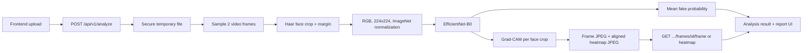

# DeepFake Shield

> **Detect. Localize. Explain. Investigate.**

DeepFake Shield is a forensic analysis platform for digital media authenticity. The **video path is now live**: the existing frontend uploads a video to FastAPI, the backend runs the trained EfficientNet-B0 checkpoint, and the result returns through the existing analysis and report workflow, now with **frame-level evidence**: the real sampled frames, the detected face region, and a Grad-CAM heatmap of what drove each frame's score.


## What is live

| Modality | Status | Current capability |
| --- | --- | --- |
| **Video** | **Production-integrated** | Face-aware two-frame EfficientNet-B0 prediction through the web UI and FastAPI, with per-frame images, face boxes, and Grad-CAM heatmaps |
| Image | Planned | Existing upload contract remains available; model work comes later |
| Audio | Planned | Existing upload contract remains available; model work comes later |

## Model card

| Item | Value |
| --- | --- |
| Architecture | EfficientNet-B0 |
| Framework | PyTorch |
| Input | Face crop, resized to `224x224` |
| Frames per video | 2 representative frames |
| Classifier | 2-class `REAL` / `FAKE` head |
| Checkpoint | `models/deepfake_shield_video_v1.pt` |
| Threshold | `0.5` fake-probability threshold |
| Device | CUDA when available, otherwise CPU |
| Explainability | Grad-CAM on the final convolutional block (`features[-1]`), fake-class logit |

### Test-set results

These are the reported results of the trained checkpoint, not generated or estimated values.

| Metric | Score |
| --- | ---: |
| Accuracy | **55.43%** |
| Precision | **97.35%** |
| Recall | **50.82%** |
| F1 | **66.78%** |
| ROC-AUC | **83.01%** |
| PR-AUC | **96.79%** |

> `confidence` is the selected class probability from the model. It is not a calibrated probability and is not legal certainty.

## Inference flow



The detector reuses the training preprocessing in `ml/data/video_dataset.py` and the model definition in `ml/models/efficientnet_baseline.py`. Frames without detectable faces are skipped; videos with no valid face crops fail cleanly instead of producing a fabricated result.

## Frame-level explainability

Every analyzed frame now comes with real evidence instead of placeholder visuals:

- **Frame image**: the sampled frame is saved as a JPEG (max width 640 px).
- **Face box**: the padded face crop the model actually saw, in source-video pixels (`[left, top, right, bottom]`).
- **Grad-CAM heatmap**: computed in the same forward pass as the prediction (scores are identical to the plain `no_grad` path). The fake-class logit is back-propagated to `features[-1]`; channel weights are the spatially averaged gradients, the map is ReLU'd, normalized per frame, upsampled to the face crop, colorized (JET), and placed on a black canvas the same size as the frame. Black areas vanish under the UI's screen blend, so the heatmap overlays the frame exactly.

In the UI, the **Suspicious Frames** section lists every analyzed frame (highest score first), with:

- the real thumbnail and the face box, outlined red when the frame is above the decision threshold;
- the true source frame number and timestamp;
- a severity band that matches the timeline colours: `HIGH` at 75% or above, `MEDIUM` at 45% or above, `LOW` below that;
- an inspector with the original frame, an adjustable Grad-CAM overlay labelled `GRAD-CAM · EFFICIENTNET-B0`, the frame score, the flagged region, and a plain-language explanation.

The "Suspicious regions" summary counts only frames the detector actually flagged (fake probability at or above `0.5`). Mock mode keeps the demo heatmap and its "Demonstration visualisation" disclaimer.

> Grad-CAM shows where the model's evidence came from; it is an explanation aid, not proof of manipulation. On authentic videos the attention is usually weak and diffuse, which is expected.

## Quick start

### 1. Start the backend

From the repository root:

```bash
cd backend
python3 -m venv .venv
source .venv/bin/activate
python3 -m pip install -r requirements.txt
python -m uvicorn app.main:app --reload
```

The API runs at `http://127.0.0.1:8000`. OpenAPI docs are available at `http://127.0.0.1:8000/docs`.

> Use `python -m uvicorn` rather than bare `uvicorn`. With a global Python install, zsh can keep running the global `uvicorn` even after the venv is activated, which fails with `ModuleNotFoundError: No module named 'fastapi'`. Running `rehash` after activating also fixes it.

The checkpoint is resolved from `models/deepfake_shield_video_v1.pt`. To use another checkpoint without changing code:

```bash
DEEPFAKE_MODEL_PATH=/absolute/path/to/model.pt uvicorn app.main:app --reload
```

### 2. Start the frontend

In a second terminal:

```bash
cd frontend
npm install
npm run dev
```

The frontend defaults to `http://127.0.0.1:8000`. Override it with `VITE_API_BASE_URL` in `frontend/.env.local` when needed, and restart `npm run dev` after any change, because Vite reads env files only at startup. Use `127.0.0.1` rather than `localhost`, so requests can't land on another service (for example a Docker container) bound to the same port. Mock mode is opt-in only:

```bash
VITE_USE_MOCK_DATA=true npm run dev
```

### 3. Upload a real video

The existing frontend uses this same request:

```bash
curl -X POST http://127.0.0.1:8000/api/v1/analyze \
	-F "file=@datasets/raw/test/00272.mp4"
```

The endpoint returns an analysis ID immediately. Poll the returned ID:

```bash
curl http://127.0.0.1:8000/api/v1/analyze/DF-YYYYMMDD-XXXXXXXX
```

The video result includes the aggregate prediction and per-frame evidence:

```json
{
	"verdict": "likely_authentic",
	"confidence": 0.941162,
	"fake_probability": 0.058838,
	"real_probability": 0.941162,
	"frames_analyzed": 2,
	"frame_scores": [
		{
			"frame_id": 0,
			"timestamp": 0.0,
			"fake_probability": 0.020694,
			"face_box": [344, 32, 498, 186],
			"thumbnail_url": "/api/v1/analyze/DF-YYYYMMDD-XXXXXXXX/frames/0/frame",
			"heatmap_url": "/api/v1/analyze/DF-YYYYMMDD-XXXXXXXX/frames/0/heatmap"
		}
	]
}
```

Fetch a frame image or its heatmap (both `image/jpeg`):

```bash
curl -o frame.jpg   http://127.0.0.1:8000/api/v1/analyze/DF-YYYYMMDD-XXXXXXXX/frames/0/frame
curl -o heatmap.jpg http://127.0.0.1:8000/api/v1/analyze/DF-YYYYMMDD-XXXXXXXX/frames/0/heatmap
```

## API surface

The existing asynchronous API is preserved:

- `POST /api/v1/analyze` - upload image, video, or audio
- `GET /api/v1/analyze/{analysis_id}` - poll status and retrieve the result
- `GET /api/v1/analyze/{analysis_id}/evidence` - retrieve evidence signals
- `GET /api/v1/analyze/{analysis_id}/report` - retrieve the report payload
- `GET /api/v1/analyze/{analysis_id}/frames/{frame_id}/{frame|heatmap}` - retrieve an analyzed frame or its Grad-CAM heatmap (JPEG; `404` for unknown analyses or frames)
- `GET /health` - service and inference-mode status

No duplicate `/predict` endpoint was added. The frontend continues to use the established upload and polling contract in `frontend/src/lib/api.ts`.

## Verify the integration

Run the backend tests:

```bash
cd backend
python3 -m pytest -q
```

Run direct inference with the repository helper:

```bash
cd ..
python3 scripts/infer_video.py \
	--video datasets/raw/test/00272.mp4 \
	--checkpoint models/deepfake_shield_video_v1.pt \
	--frames 2
```

Build and lint the frontend:

```bash
cd frontend
npm run lint
npm run build
```

The current backend verification (13 tests) covers model loading, CPU execution, face extraction, preprocessing, real-video inference, API upload, response fields, no-face handling, Grad-CAM and frame artifact generation (frame and heatmap written at matching sizes, valid face boxes), and serving those artifacts over the API, including `404`s for unknown frames and analyses.

## Recent changes

### Fixes

| Issue | Cause | Fix |
| --- | --- | --- |
| `ModuleNotFoundError: No module named 'fastapi'` on `uvicorn app.main:app` | The shell ran the global Python 3.13 `uvicorn` instead of the venv's | Start the server with `python -m uvicorn` (or run `rehash` after activating) |
| `Backend request failed (404)` when starting an analysis | `frontend/.env.local` pointed `VITE_API_BASE_URL` at port `8001`, where an unrelated Docker service was running | Pointed it back at `http://127.0.0.1:8000` |
| Video viewer showed a stock photo instead of the uploaded video | `sample-frame.jpg` was passed as the `<video>` poster; images and the processing page always showed the stock photo | The viewer, image viewer, and processing preview use the uploaded file; Safari is nudged to paint the first frame; the frame is fitted instead of cropped |
| Suspicious frames showed black boxes, `UNKNOWN` severity, wrong frame numbers, and a fake heatmap | The frontend had no frame images, hard-coded severity, used list positions as frame numbers, and drew a demo gradient | The backend now produces real frames and Grad-CAM heatmaps; the frontend maps real frame IDs, scores, face boxes, and severity |
| Fake "Face boundary · HIGH" overlay on real image results | A mock overlay was always drawn | Shown in mock mode only |

### Additions

- **Backend**: Grad-CAM in `VideoDetector` (`backend/app/services/video_detector.py`), per-frame JPEG and heatmap artifacts, `face_box` / `thumbnail_url` / `heatmap_url` on `FrameScore` (`backend/app/schemas.py`), and the frame artifact endpoint (`backend/app/main.py`).
- **ML**: `FaceCropper.locate()` in `ml/data/video_dataset.py` returns the crop box; `crop()` uses it and is unchanged for training.
- **Frontend**: a shared `FrameImage` component (`frontend/src/components/analysis/FramePreview.tsx`) renders frames at the video's real aspect ratio, so overlays stay aligned; `SuspiciousFrames`, `FrameInspector`, and `HeatmapViewer` use real data; `getUploadedMediaUrl()` in `frontend/src/lib/api.ts` serves both image and video previews.
- **Tests**: `test_inference_writes_frame_and_gradcam_artifacts` and `test_video_frame_artifacts_are_served`.

## Known limitations

- **In-memory storage**: analysis records live in memory. Restarting the backend, including an automatic `--reload`, clears them, and old analysis IDs return `404`.
- **Frame artifacts are temporary**: they are written to the system temp directory (`deepfake-shield-artifacts/`) and wiped on startup, matching the in-memory records.
- **Original media is not kept**: the uploaded file is deleted after analysis, so the video or image preview works only in the browser tab that uploaded it. After a reload, the viewer shows "Preview unavailable". The extracted frames and heatmaps still load from the backend.
- **Two sampled frames**: the detector analyzes 2 frames per video (`DEFAULT_FRAMES` in `video_detector.py`), so the frames section shows at most two entries.
- **Image and audio** analysis still return placeholder signals.
- **External drives**: on exFAT drives macOS creates `._*` files, which produce `Ignoring invalid distribution` warnings from pip, ESLint parse errors, and git pack warnings. These are harmless; clean them with `dot_clean -m .`.

## Dataset and research workflow

The workspace contains `6,529` `.mp4` videos under `datasets/raw/`. Raw data is never modified. Generated reports, splits, experiments, and evaluation artifacts belong under `artifacts/`.

Inspect and split the dataset from the repository root:

```bash
python3 scripts/inspect_dataset.py
python3 scripts/split_dataset.py
```

Run a bounded training sanity check:

```bash
python3 scripts/train_baseline.py --epochs 1 --limit 20 --frames-per-video 4
python3 scripts/evaluate_baseline.py --checkpoint artifacts/experiments/baseline/best_model.pt
```

Research safeguards:

- Split at the video or source level, never at the frame level.
- Keep model confidence separate from the broader forensic assessment.
- Treat Grad-CAM as an explanation aid, not proof of manipulation.
- Review dataset licenses before downloading or redistributing media.

## Dataset links

- [Deepfake Detection Challenge dataset](https://www.kaggle.com/c/deepfake-detection/data) - video deepfake detection data.
- [Real and Fake Face Detection dataset](https://www.kaggle.com/datasets/ciplab/real-and-fake-face-detection) - real/fake face image data.
